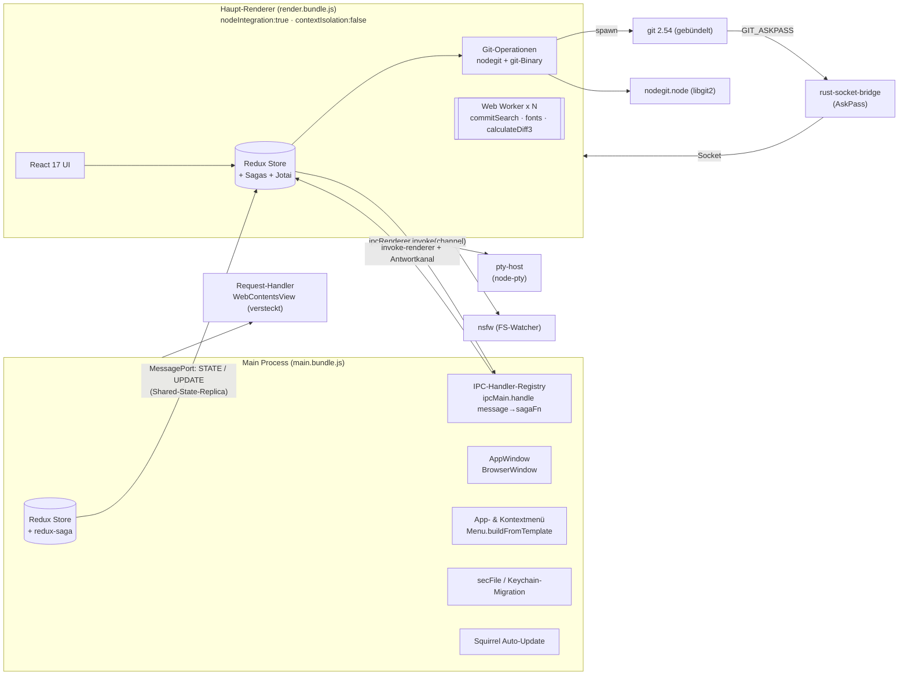
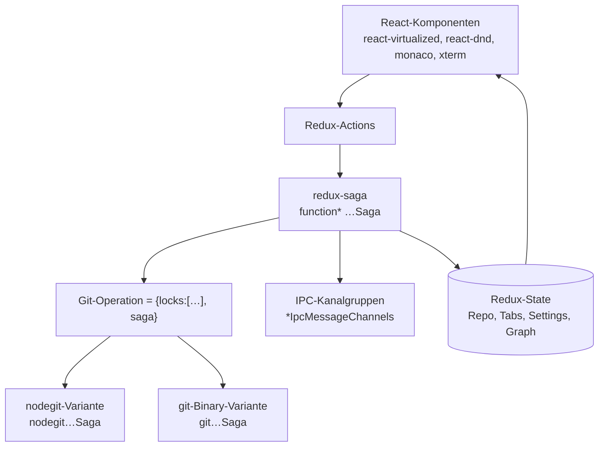

# 02 – Architekturübersicht (beobachtet)

Legende: **[N]** nachgewiesen · **[P]** plausibel · **[U]** unbekannt. Alle Aussagen beziehen sich auf GitKraken 12.5.0, statisch analysiert. Eigene Vorschläge stehen ausschließlich in [08-implementation-plan.md](08-implementation-plan.md).

## Prozessmodell

| Baustein | Beobachtung | Status / Fundstelle |
|---|---|---|
| Main-Einstieg | `startMainProcess.js` setzt `global.clientType`/`global.mode`, lädt `../main` | [N] `src/main/static/startMainProcess.js` |
| Splash | eigenes `BrowserWindow` mit `javascript:false`, lädt `splash/index.html` | [N] `main.bundle.js` (Kontext `showSplashScreen`) |
| Upgrade-Skripte | Lazy-Chunks führen versionierte Migrationen aus (`LATEST_UPGRADE_SCRIPT`, `updateLastUpgradeScriptRun("v6.1.0")`) | [N] `main.bundle.js`, `605.main.bundle.js` |
| Hauptfenster | Klasse mit `this.browserWindow`, Titel „GitKraken Desktop“, `titleBarStyle:"hidden"` auf macOS, min. 950×675, Default 1251×800 | [N] `919.main.bundle.js` (`minWidth:950,minHeight:675`), `DEFAULT_APP_WINDOW_DIMENSIONS={width:1251,height:800}` |
| Request-Handler | `WebContentsView` mit Node-Integration lädt `requestHandler/index.html`; Init-Promise `request-handler-initialized` | [N] `795.main.bundle.js` |
| Worker | 4 gepoolte Worker + dedizierte Worker `commitSearch`, `fonts`; Shared-Worker-Definition `calculateDiff3` | [N] `render.bundle.js@7532164` (`for(let at=0;at<4;…)new Worker`), `dedicatedWorkerDefinitions={commitSearch,fonts}` |
| Terminal | separates `pty-host.bundle.js` + `node-pty` | [N] Dateien; Startfehler `Cli-PtyStartError` |
| CLI | `cli.js` spawnt die App detached mit geparsten Argumenten (yargs) | [N] `src/main/static/cli.js` |
| Deep Links | `setAsDefaultProtocolClient("gitkraken", process.execPath…)`; URI-Kommandos `drafts, login, preferences, repo, repolink, token, workspaces` | [N] `main-all`, `URI_COMMAND_NAME={…}` |
| Single Instance | `requestSingleInstanceLock` (5 Treffer) | [N] Zählung |
| Telemetrie | Sentry (`@sentry/electron`, IPC `ge.IPCChannel.*`), OpenTelemetry-Pakete | [N] `package.json`, ipcMain-Registrierungen |

## Schichten im Renderer

- **Operationen als Daten**: Git-Operationen werden als Objekte `{locks:[…],saga:function*xSaga}` definiert, z. B. `nodegitCheckoutAndUpdateHead=({config,repo,head,…})=>({locks:[Mr.INDEX],saga:function*nodegitCheckoutAndUpdateHeadSaga…})` **[N]** `render.bundle.js@497820`. 253 solcher Operationen extrahiert (`.work/git-ops.txt`).
- **Doppel-Backend**: viele Operationen existieren paarweise (`nodegitAmendSaga`/`gitAmendSaga`, `nodegitResetSaga`/`gitResetSaga`, `createNodeGitAnnotatedTagSaga`/`createGitBinaryAnnotatedTagSaga`) **[N]**. Auswahlregel siehe [04-git-integration.md](04-git-integration.md).
- **Fehler-Toasts** sind i18n-Keys (`"Error-PushFailed"`, `"Error-RebaseFailed"` …) **[N]** – über 200 Keys im Renderer gefunden.
- **Zustandsverwaltung**: Redux (4 `createStore`-Treffer im Renderer) **[N]**; `jotai-immer`, `jotai-effect` in Dependencies **[N]**, im Haupt-Render-Bundle aber kein Treffer für „jotai“ **[U]** (evtl. umbenannt/inlined).

## Lokale Datenspeicherung

| Ort | Inhalt | Status |
|---|---|---|
| `~/.gitkraken/` (`_dev`, `_staging`, `_system_test` je Modus) | Settings-Root | [N] `getSettingsPath` mit Mapping `{development:".gitkraken_dev",…,production:".gitkraken"}` (`main-all@~602932`) |
| `~/.gitkraken/config` | App-Settings (JSON, `writeJSON …{spaces:2}`) inkl. `windowSettings`, `lastUpgradeScriptRun` | [N] Migrationscode `605.main.bundle.js` |
| `~/.gitkraken/profiles/<guid>/` | Profil; Unterordner `repoSettings`, `localRepoCache`, `ssh` | [N] Migrationscode (`i.join(c,"repoSettings")`, `moveSync(t,c,"localRepoCache")`) |
| `secFile` (global und pro Profil) | verschlüsselte Secrets; Migration von `keytar` (Key `"GitKraken"`) | [N] `migrateFileSec(join(t,"secFile"),appId)`; `keytarKey:"GitKraken"` |
| `logs/`, `error-log.txt`, `perf-timings.json` | Logs/Performance | [N] Verzeichnisnamen (Inhalt nicht gelesen) |
| `localStorage` | Renderer (2 Treffer), Migration 2.0.0 per `retrieveLocalStorage` | [N] |
| SQLite/IndexedDB | keine Nutzung gefunden (sqlite-Treffer sind nur Datenbank-Namenslisten einer Lib) | [N] negativ, Suchgrenze: Regex `sqlite`, `indexedDB.` |

## Sicherheitsrelevante Architekturmerkmale (beobachtet)

- Hauptfenster und Request-Handler: `contextIsolation:false, nodeIntegration:true, nodeIntegrationInWorker:true` **[N]** `919.main.bundle.js`, `795.main.bundle.js`.
- CSP im Hauptfenster: `script-src 'self' https://www.youtube.com 'unsafe-eval' …` **[N]** `entryPoints/main/index.html`.
- Einziges `contextBridge.exposeInMainWorld('HostIPC', …)` in `webviewPreload.js` (für eingebettete Webviews) **[N]**.

→ Für die eigene App wird bewusst **das Gegenteil** vorgeschlagen (Sandbox + Preload), siehe 08.
