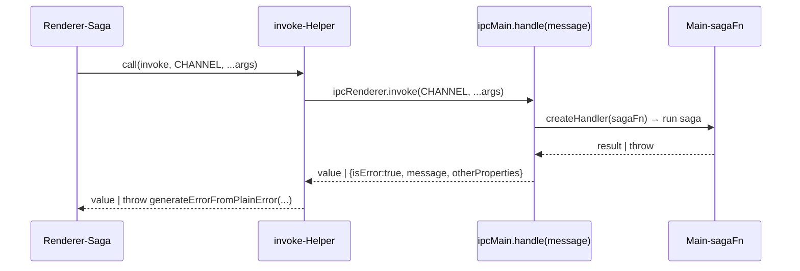

# 03 – Electron-Interna

Legende: **[N]** nachgewiesen · **[P]** plausibel · **[U]** unbekannt. `main-all` = Konkatenation aller `src/main/static/*.main.bundle.js` + `main.bundle.js` (Offsets beziehen sich auf diese Datei, erzeugt mit `cat …/*.main.bundle.js main.bundle.js`). `render` = `src/render/static/entryPoints/main/render.bundle.js`.

## Fenster & WebContents

| Fenster | webPreferences | Inhalt | Status |
|---|---|---|---|
| Splash | `javascript:false, webgl:false` | `splash/index.html` | [N] main.bundle.js (`showSplashScreen`) |
| Hauptfenster (`AppWindow`) | `contextIsolation:false, nodeIntegration:true, nodeIntegrationInWorker:true, subpixelFontScaling:true, directWrite:true` | `entryPoints/main/index.html` | [N] `919.main.bundle.js` |
| Request-Handler | `WebContentsView`, gleiche Node-Flags | `entryPoints/requestHandler/index.html?loadSettings=…` | [N] `795.main.bundle.js` |
| Migration 2.0.0 | `contextIsolation:false,nodeIntegration:true` | `upgrades/v2_0_0_retrieveLocalStorageStep.html` | [N] `605.main.bundle.js` |

- `loadSettings` werden als JSON im Query-String übergeben und im Renderer in `initializeGlobals.js` als nicht-schreibbare Globals definiert (`appPath`, `appDataPath`, `mode`, `clientType`, `version`, `bootUpEnvironment` …) **[N]** `entryPoints/shared/initializeGlobals.js`.
- Externe Links: `setWindowOpenHandler` erlaubt nur `http:`, `https:`, `mailto:` → `openExternal`, sonst `deny` **[N]** `main-all@567697`.
- Fenster-Close auf macOS kann per `hideOnClose` in Hide umgewandelt werden **[N]** `919.main.bundle.js`.
- Render-Prozess-Absturz (`render-process-gone`) wird geloggt und als Event weitergereicht **[N]** `main-all@567697`.

## Preload / contextBridge

- **Kein Preload** für Hauptfenster und Request-Handler; der Renderer nutzt `require('electron')`, `require('fs')` usw. direkt **[N]** (`entryPoints/main/index.js` ruft `require('../../../../js/start')`, `ipcRenderer.send(...)`).
- Einziges Preload: `webview/webviewPreload.js` → `contextBridge.exposeInMainWorld('HostIPC', { send: sendToHost, on, once })` **[N]**.

## IPC-Architektur

### 1. Typisierte Saga-Kanäle (Renderer → Main, request/response)

- Main registriert eine Liste `{message, sagaFn, oneWay?, preserveSender?}`. `oneWay` → `ipcMain.on` + Dispatch; sonst `ipcMain.handle(message, createHandler(sagaFn))`. Doppelte Registrierung wird geloggt **[N]** `main-all@375421`.
- Renderer-Helper: `await ipcRenderer.invoke(ch,...args)`; bei `lt.isError` wird ein Error rekonstruiert **[N]** `render@5698128`.
- Fehler werden als Plain-Object serialisiert (`generatePlainObjectIpcError…`) **[N]** `render@6368883`.

**43 Kanalgruppen** (`*IpcMessageChannels`) **[N]**, Werte sind identisch mit Schlüsseln (z. B. `systemIpcMessageChannels.OPEN_PATH = "OPEN_PATH"`):

`analytics, app, autoUpdate, cli, clientManager, cloneRepo, communication, compose, contextMenu, creds, dateTime, deepLinkSaga, enrichedItems, focusView, gitConfig, git, gpg, hostingService, integration, log, metrics, notification, onboarding, organization, profile, project, promise, pullRequest, registration, remotePrivacy, repoManagement, repoSettings, requestHandler, request, settings, sharedDrafts, sync, system, tabs, team, theme, window`

Für eine Git-App relevante Kanäle (Auszug, alle [N] als Handler-`message` im Main):

| Gruppe | Kanäle |
|---|---|
| `system` | `BROWSE_FOR_OPEN_PATH(S)`, `BROWSE_FOR_SAVE_PATH`, `OPEN_EXTERNAL`, `OPEN_PATH`, `SHOW_ITEM_IN_FOLDER`, `SHOW_SYSTEM_DIALOG`, `TRASH_ITEM`, `READ/WRITE_TEXT_(FROM/TO)_CLIPBOARD`, `ADD_SYSTEM_FONTS`, `GET_WEBCONTENTS_ID` |
| `creds` | `ACQUIRE_OR_WAIT_FOR_CREDENTIALS_LOCK`, `RELEASE_CREDENTIALS_LOCK`, `GET_HTTP_CREDENTIALS`, `SET/CLEAR_CREDENTIALS_FOR_URL`, `GENERATE_SSH_KEY_FOR_PROFILE`, `SET_SSH_ENCRYPTED_PASSWORD`, `RESET_ALL_CREDENTIALS` |
| `gitConfig` | `GET_GIT_CONFIG_PATHS`, `GET/SET/UNSET_GIT_CONFIG_SETTING`, `SET_MULTIPLE_GIT_CONFIG_SETTING`, `REFRESH_GIT_CONFIG`, `UPDATE_USE_LOCAL_GIT_CONFIG` |
| `git` | `EXECUTOR_ERRORED`, `UPDATE_GIT_INSTANCES` |
| `gpg` | `DETECT_GPG_VERSION`, `GENERATE_GPG_KEY`, `LOAD_GPG_KEYS`, `GPG_PASSPHRASE_UPDATED/CLEARED` |
| `repoSettings` | `LOAD_REPO_SETTINGS`, `SET/RESET_REPO_SETTING`, `COPY_FROM_MAIN_WORKTREE`, `WEB_CONTENTS_OPENED/CLOSED_REPO` |
| `project` (Workspaces) | `CREATE/EDIT/DELETE_PROJECT`, `LOAD_PROJECTS`, `ADD_REPO_TO_PROJECT`, `ADD_TO_RECENT_PROJECTS_LIST`, … |
| `window` | `DESTROY_WINDOW`, `RELOAD_WINDOW`, `TOGGLE_MAXIMIZED`, `MENU_TRANSLATION_DEPENDENCIES_UPDATED` |
| `theme` | `SET_THEME` |
| `autoUpdate` | `DOWNLOAD_UPDATE`, `INSTALL_UPDATE`, `RETRY_UPDATE` |
| `request` | `MAKE_REQUEST`, `CALL_NET_REQUEST`, `RESOLVE_PROXIES`, `SET_ETAG` |

Daneben viele Cloud-/Account-Gruppen (`registration`, `organization`, `integration`, `pullRequest`, `focusView`, `sharedDrafts`) – für eine lokale Git-App nicht nötig.

### 2. Main → Renderer-Aufrufe (`invoke-renderer`)

Main sendet `invoke-renderer` mit `{requestId, args}`; der Renderer führt den registrierten `sagaFn` aus und antwortet auf dem Kanal `` `${message}-${requestId}` `` (einmaliger `ipcMain.once`) **[N]** `main-all@947056`, `render@6368883` (`registerMainToRenderIpcHandlers`).

### 3. Shared-State-Replikation (Main-Store → Renderer)

- Renderer erzeugt einen MessagePort und sendet `REPLICA_READY` mit dem Port; Main antwortet mit `{type:"STATE", state:getSharedState()}` und danach inkrementellen `{type:"UPDATE", update, updateIndex}`; Renderer bestätigt per `updateIndex` (Ack-Promises, `waitForReplicaAck`) **[N]** `main-all@374349`, `main-all@375421`.
- Nicht klonbare Updates werden im Nicht-Produktionsmodus mit „An object could not be cloned.“ geloggt **[N]**.

### 4. Roh-Kanäle (Strings)

| Richtung | Kanäle | Status |
|---|---|---|
| R→M | `window-command`, `reload-window`, `window-toggle-dev-tools`, `quit`, `update-url-changed`, `log`, `set-access-token-cookie`, `request-handler-initialized`, `retrieveLocalStorage`, `ipc:task:result`, `ipc:task:cancel`, `render-process:error-on-startup` | [N] ipcMain-Registrierungen / Renderer-Sends |
| M→R | `context-menu-open`, `context-menu-action`, `context-menu-close`, `quit-application`, `invoke-renderer` | [N] `main-all@567697`, `render@4834876` |

### Kontextmenüs

Main hört auf `webContents.on("context-menu")` und schickt `context-menu-open` an den Renderer; dieser dispatcht `spawnContextMenu`; Aktionen kommen als `context-menu-action` zurück → `handleContextMenuItemAction` **[N]**. Die Menüs selbst sind **nativ**: der Renderer schickt `POPUP_MENU` per IPC, Main baut sie mit `Menu.buildFromTemplate` + `popup`, der Klick kommt per Menü-ID an einen Saga-Handler zurück **[N]** – Fundstellen in [05-ui-components.md](05-ui-components.md).

## Weitere Main-APIs (Zählung in `main-all`)

| API | Treffer | Status |
|---|---|---|
| `requestSingleInstanceLock` | 5 | [N] |
| `setAsDefaultProtocolClient("gitkraken", …)` | 1 | [N] |
| `Menu.buildFromTemplate` / `setApplicationMenu` | 2 / 1 | [N] |
| `powerMonitor` | 15 | [N] (Zweck [P]: Refresh nach Sleep) |
| `nativeTheme.` | 4 | [N] (System-Dark-Mode, `EARLIEST_OS_SUPPORTS_DARK_THEME`) |
| `session.defaultSession.` | 9 | [N] (Proxy/Cookies [P]) |
| `protocol.(handle|register…)` | 3 | [N], Schema-Namen [U] |
| `MessageChannelMain` | 1 | [N] |
| `crashReporter` | 7 | [N] |
| `utilityProcess.fork` | 0 | [N] negativ |
| `globalShortcut`, `Tray` | 0 | [N] negativ |

## Native Erweiterungen

Siehe Tabelle in [01-installation.md](01-installation.md#native-module-appasarunpackednode_modules). Die Exporte der `.node`-Dateien wurden nicht verifiziert **[U]** (REA: ein angefordertes `.node`-Modul ist kein verifizierter nativer Export).
