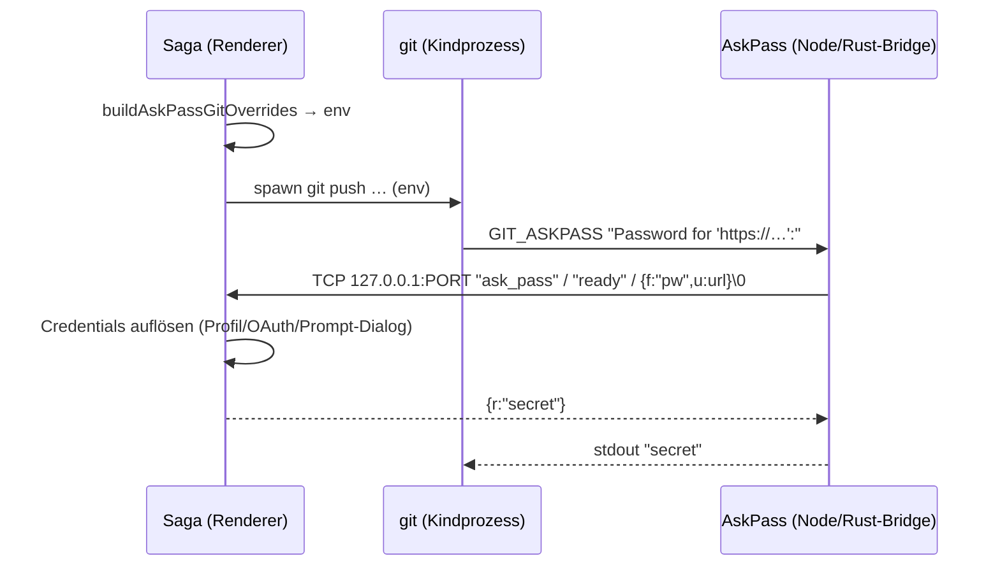

# 04 – Git-Integration

Analysiertes Artefakt: GitKraken Desktop **12.5.0** (macOS arm64), Kopie unter `.work/app` (entpacktes `app.asar`) und `.work/app.asar.unpacked`. Nur statische Analyse; die App wurde nicht gestartet.

**Legende**
- **[nachgewiesen]** – wörtlich im Artefakt gefunden (Fundstelle angegeben)
- **[plausibel]** – Schlussfolgerung aus mehreren Funden, nicht direkt belegt
- **[unbekannt]** – nicht gefunden; Suchgrenze angegeben

**Abkürzungen für Fundstellen** (Byte-Offsets in minifizierten Ein-Zeilen-Bundles, relativ zu `.work/app/`):

| Kürzel | Datei |
|---|---|
| `R` | `src/render/static/entryPoints/main/render.bundle.js` (12,1 MB) |
| `W` | `src/render/static/entryPoints/worker/worker.bundle.js` |
| `M57` | `src/main/static/57.main.bundle.js` |
| `U` | `.work/app.asar.unpacked/` |

> Hinweis: Minifizierte Variablennamen (`Mr`, `la`, `gn` …) sind nicht stabil. Stabil sind Funktionsnamen von Generatoren (`function*xyzSaga`), exportierte Property-Namen und String-Literale.

---

## 1. Gesamtbild

```mermaid
flowchart LR
  subgraph Renderer["Renderer-Prozess (nodeIntegration, Redux + redux-saga)"]
    UI[React-UI] -->|dispatch| Saga[Saga-Operationen<br/>&#123;locks, saga&#125;]
    Saga --> LockMgr[Lock-Manager<br/>handleLockRequest]
    Saga -->|gitBinaryEnabled = false| NG[nodegit / libgit2<br/>@axosoft/nodegit 0.28.0-alpha.38]
    Saga -->|gitBinaryEnabled = true| GK[gkGit-Fassade]
    GK --> GitCmd[git.* Befehls-Wrapper<br/>runGitCmd]
    GitCmd -->|Executor runGitCmdSpawn| CP[child_process.spawn]
    GitCmd -->|Executor runGitCmdServer<br/>Feature-Flag| RSS[node-spawn-server<br/>Rust-Binary]
    Saga --> WK[Web-Worker<br/>commitSearch / calculateDiff3]
    Saga --> NSFW[nsfw File-Watcher]
  end
  CP --> GIT[(gebündeltes git 2.54.0<br/>U/git/bin/git)]
  RSS --> GIT
  GIT -->|GIT_ASKPASS / SSH_ASKPASS| AP[AskPass.sh → AskPassClient.js<br/>oder rust-socket-bridge]
  AP -->|TCP 127.0.0.1:GITKRAKEN_SOCKET_SERVICE_PORT| Saga
  Saga -->|ipcRenderer| Main[Main-Prozess<br/>credsIpcMessageChannels]
```

**[nachgewiesen]** Git-Operationen laufen im **Renderer-Prozess** (nodegit wird dort per `require` geladen): `R@1716871` `11950(Ve){"use strict";Ve.exports=require("@axosoft/nodegit")}`.
**[plausibel]** Der Main-Prozess führt selbst keine Git-Operationen aus. Im Main-Bundle kommt `nodegit` nur einmal als String vor; Credentials werden dort aber verwaltet (Abschnitt 6).

---

## 2. Lock-Modell

### 2.1 Operationsform
**[nachgewiesen]** Git-Operationen sind Objekte der Form `{ locks, logging?, saga: function* … }`, z. B. `R@497951` `nodegitCheckoutAndUpdateHead=(…)=>({locks:[Mr.INDEX],saga:function*nodegitCheckoutAndUpdateHeadSaga`. In `.work/git-ops.txt` sind 253 solcher benannten Sagas aufgelistet.

### 2.2 Lock-Enum (vollständig)
**[nachgewiesen]** Das Modul `89370` (`R@11506446`–`R@11510500`) definiert `ReadLock` und `WriteLock` mit je 12 Werten. Snippet `R@11507515`: `Ve.CONFIG_READ="config_lock_read",Ve.GITATTRIBUTES_READ="gitattributes_lock_read"`.

| Ressource | Write-Lock (exklusiv) | Read-Lock (geteilt) | Alias |
|---|---|---|---|
| Analytics | `analytics_persist_lock_write` | `analytics_persist_lock_read` | `ANALYTICS_PERSIST` |
| Cloud-Notifications | `cloud_notifications_lock_write` | `…_read` | `CLOUD_NOTIFICATIONS` |
| Git-Config | `config_lock_write` | `config_lock_read` | `CONFIG` |
| .gitattributes | `gitattributes_lock_write` | `…_read` | `GITATTRIBUTES` |
| .gitignore | `gitignore_lock_write` | `…_read` | `GITIGNORE` |
| GPG | `gpg_lock_write` | `gpg_lock_read` | `GPG` |
| **Index** | `index_lock_write` | `index_lock_read` | `INDEX` |
| Metrics | `metrics_persist_lock_write` | `…_read` | `METRICS_PERSIST` |
| Notification-Persist | `notification_persist_lock_write` | `…_read` | `NOTIFICATION_PERSIST` |
| Phone-Home (Lizenz) | `phone_home_lock_write` | `…_read` | `PHONE_HOME` |
| Remote | `remote_lock_write` | `remote_lock_read` | `REMOTE` |
| Repo-Settings | `repo_settings_lock_write` | `…_read` | `REPO_SETTINGS` |

**[nachgewiesen]** Der Alias ohne Suffix (z. B. `INDEX`) entspricht dem Write-Lock: `at.INDEX=$n` mit `$n = INDEX_WRITE`. Exportiert werden außerdem `NON_EXCLUSIVE_LOCKS` (alle Read-Locks), `WRITE_TO_READ_LOCKS`, `READ_TO_WRITE_LOCKS` und `validLocks`.

**Häufigkeit in Operationen** (statische Zählung der `locks:[X.NAME`-Muster in `R`) **[nachgewiesen]**: INDEX 120, CONFIG 75, REPO_SETTINGS 49, INDEX_READ 42, GITIGNORE 12, CONFIG_READ 12, GITATTRIBUTES 7, INDEX_WRITE 6, REMOTE 3, GPG_READ 1, NOTIFICATION_PERSIST 1.

### 2.3 Semantik (`handleLockRequest`, `R@2829400`ff.)
- **[nachgewiesen]** Ein **Array** `locks:[…]` bedeutet, dass die Locks *erworben* werden (Klasse „acquired“). Ein **Objekt** `locks:{INDEX_READ:…}` bedeutet, dass sie nur *deklariert* werden. Im Production-Modus wird bei Objekt-Locks nichts erworben: `!$n&&zn)return wr.recordEvent(Fn,"DECLARED_LOCKS"…`.
- **[nachgewiesen]** Ein Write-Lock erwirbt den passenden Read-Lock automatisch mit: `gr.forEach((Ve=>{const at=sr.WRITE_TO_READ_LOCKS[Ve];at&&!gr.includes(at)&&gr.push(at)}))`.
- **[nachgewiesen]** Eine Kind-Saga darf nicht mehr Locks verlangen als ihre Eltern-Saga (nur außerhalb von Production geprüft): `"Attempted to acquire more locks for a child saga than parent saga …"`.
- **[nachgewiesen]** Bereits gehaltene Locks werden wiederverwendet (`difference(gr,Wn)`). Nur die neuen werden über `lr.acquireLocks(Kr,Wn)` geholt, und `releaseLocks` gibt sie wieder frei.
- **[nachgewiesen]** Es gibt Lifecycle-Hooks (`started/succeeded/failed/finished`) und Saga-Extensions (`registerExtension`), siehe `R@2829400`. Darüber laufen u. a. Logging und Fehler-Callbacks.

**Vorschlag für die eigene App:** Eine Read/Write-Lock-Queue pro Repo und Ressource, die im Main- oder Git-Service-Prozess läuft.

---

## 3. Dual-Backend: nodegit vs. git-Binary

### 3.1 Umschalter
- **[nachgewiesen]** Das Setting heißt `gitBinaryEnabled` und kommt aus den App-Settings: `R@11631085` `at.getIsGitBinaryEnabled=(0,gn.createSelector)(getAppSettings,(Ve=>Ve.gitBinaryEnabled))`. Der Selektor wird 206-mal referenziert.
- **[nachgewiesen]** Zugehörige UI-Strings: `GitBinaryLabel`, `GitBinaryDescription`, `DisablingGitBinaryWillPreventSeveralGitFeatures`, `ToSquashMergeYouMustEnableGitBinary`, `RebaseOntoSelectionRequiresGitBinary`, `ShallowOrSparseCloneOnlyAvailableInGitBinaryMode`.
- **[plausibel]** Der Default ist „aktiviert“, und der Schalter steht unter *Preferences → Experimental/Git*. Der Default-Wert selbst wurde nicht gefunden (Suche: `gitBinaryEnabled:` in `R` ohne eindeutigen Default-Treffer).

### 3.2 Verzweigungsmuster
**[nachgewiesen]** Typisch ist ein früher Rücksprung auf den nodegit-Pfad, wenn das Binary deaktiviert ist:
- Push `R@8268827`: `if(!(yield(0,$n.select)(Mr.getIsGitBinaryEnabled)))return yield(0,$n.call)(ba.async.push,…)`
- Fetch `R@8257900`: `…getIsGitBinaryEnabled)))return yield(0,$n.call)(ba.async.fetch,…`
- Stage `R@12113146`: `…return yield(0,sr.call)(Mr.async.stagePaths,…`
- Commit `R@3353654`: `mn?Ps.gitHasStagedFiles:Ps.nodeGitHasStagedFiles`

Viele Operationen gibt es daher doppelt (`nodegitAmendSaga`/`gitAmendSaga`, `nodegitResetSaga`/`gitResetSaga`, `nodeGitCreateCommitSaga`/`gitDoCommitUnsafeSaga` …, siehe `.work/git-ops.txt`).

### 3.3 Was nodegit immer erledigt (auch im Binary-Modus) [plausibel]
nodegit (`Repository.open`, `R@4567853`) liefert das Repo-Objekt, das überall durchgereicht wird (`repo.workdir()`, `repo.path()`, `repo.isMerging()`, `repo.isRebasing()`). Außerdem nutzt es:
- **Commit-Graph-Laden** über `Revwalk.commitWalk(max,{returnPlainObjects:!0})` (`R@3366405`) **[nachgewiesen]**
- **Undo/Redo via Reflog** über `Reflog.read`, `Repository.open` (`R@511535`) **[nachgewiesen]**
- Ahead/Behind (`Graph.aheadBehind`), Lookups (`Branch.lookup`, `Commit.lookup`), `AnnotatedCommit.fromRef` für Rebase **[nachgewiesen]**, Zählung der `NodeGit.X.y(`-Aufrufe.

Gefundene nodegit-Klassenaufrufe **[nachgewiesen]**: `Branch.lookup`(10), `Commit.lookup`(8), `Tag.create`(5), `Reflog.read`(3), `Cred.*`(6), `Branch.upstream`, `Status.file`, `Tag.lookup`, `Oid.fromString`, `Config.openDefault`, `Remote.setUrl/setPushurl/lookup`, `Reference.nameToId/remove`, `Repository.open`, `Clone.clone`, `Apply.apply`, `Submodule.status`, `Graph.aheadBehind`, `AnnotatedCommit.fromRef`, `Merge.merge`, `Merge.commits`, `Stash.save`, `Revwalk.SORT.*`.
**[unbekannt]** Zusätzlich kommen Instanzmethoden vor (`repo.createRevWalk`, `index.writeTree`, …). Die Zählung erfasst nur statische `Klasse.methode(`-Muster.

### 3.4 Git-Befehls-Wrapper (`git.*`) und Fassade `gkGit`
**[nachgewiesen]** Ein Modul mit Wrapper-Funktionen ruft `runGitCmd({args:["<subcmd>",…],options})` auf, z. B. `R@1634748` `return(0,gn.runGitCmd)({args:["status",...lt],options:Ve})`. Darüber liegt `gkGit` (Modul `61930`, `R@7537635`), z. B. `clone:async function(…){Ve.processStderrCallback=(0,sr.makeprogressCloneStderr)(en?.emitter),await zn.git.clone(…)`.

Aus `runGitCmd`-Aufrufen extrahierte Subcommands mit Wrapper-Namen **[nachgewiesen]**:

| git-Subcommand | Wrapper |
|---|---|
| add, apply, cat-file, check-attr, check-ref-format, checkout, cherry-pick, clean, clone, commit, commit-tree, config, diff, fetch, for-each-ref, hash-object, init, log, ls-files, ls-tree, merge-base, merge-tree, pull, push, rebase, reflog, reset, restore, rev-parse, revert, rm, show, show-ref, status, switch, tag, update-index, verify-commit, write-tree | gleichnamig (camelCase) |
| branch | `branch`, `branchSetUpstream` |
| lfs | `checkout, clean, dependencyCheck, fetch, files, install, prune, pull, push, smudge, track, untrack` |
| maintenance | `maintenanceRun` |
| remote | `remote, remoteGetUrl, remoteSetBranches, remoteSetHead` |
| rev-list | `revList, revListCommits` |
| sparse-checkout | `sparseCheckoutDisable/List/Reapply/Set` |
| stash | `stashApply, stashDrop, stashList, stashPush` |
| submodule | `submoduleAdd/Init/Deinit/Foreach/SetUrl/Status/Update` |
| worktree | `worktreeAdd/List/Lock/Prune/Remove/Unlock` |

**[nachgewiesen]** Einen eigenen `git merge`-Wrapper gibt es in dieser Liste nicht. `_gitMergeSaga` (`R@8241078`) nutzt andere Wege.
**[plausibel]** Merge im Binary-Modus läuft über `merge-tree`/`commit-tree` oder `pull`. Das ist nicht belegt.

---

## 4. Wie das git-Binary gestartet wird

### 4.1 Pfad zum gebündelten git
**[nachgewiesen]** `R@2325171`:
`getPackagedGitRootPath=()=>…join((0,Wn.getElectronAppUnpackedPath)(),"git")` und
`getPackagedGitPath=()=>…join(getPackagedGitRootPath(),..."win32"===process.platform?["cmd","git.exe"]:["bin","git"])`
→ macOS: `app.asar.unpacked/git/bin/git` (Mach-O arm64, Version 2.54.0, per `strings` ermittelt).

**[nachgewiesen]** Optional lässt sich ein System-git wählen: `getGitExecutablePath = (packagedPath, selectedGitPath, gitInstancesByPath, isGitBinaryEnabled) => en&&at&&lt[at]?at:Ve` (`R@9536973`). Die eigene Installation wird also nur genutzt, wenn das Binary aktiv ist und die gewählte Instanz bekannt ist.

### 4.2 Laufzeit-Umgebung des gebündelten git
**[nachgewiesen]** `getPackagedGitRuntimeEnvironment` (`R@2325400`ff.):
- darwin: `GIT_EXEC_PATH=<root>/libexec/git-core`; `GIT_TEMPLATE_DIR=<root>/share/git-core/templates`, sofern nicht vom Nutzer gesetzt
- linux: zusätzlich `GIT_SSL_CAINFO=<root>/ssl/cacert.pem`
- win32: `GIT_EXEC_PATH=<root>/{mingw64|mingw32|clangarm64}/libexec/git-core`

### 4.3 Executors
- **[nachgewiesen]** `runGitCmdSpawn` (`R@7961433`): nutzt `child_process.spawn(gitPath, gitArgs.concat(args), opts)` mit `stdio:["ignore","pipe","pipe"]`. Stdout und Stderr werden auf je **50 MB** begrenzt (`ba=52428800`, bei Überschreitung `SIGTERM`). Prozesse werden pro `cwd` verfolgt, damit `killGitProcesses(cwd)` sie beenden kann. Erlaubte Exit-Codes sind konfigurierbar (`allowedExitCodes`).
- **[nachgewiesen]** `runGitCmdServer` (`R@249702`) nutzt `new RustSpawnServer(getNodeSpawnServerPath())`. Der Pfad ist `app.asar.unpacked/node_modules/@axosoft/node-spawn-server/target/release/node-spawn-server` (`R@2325400`ff.). Es gibt einen Fallback auf Spawn, sobald der Server einen Fehler meldet (`registerOnServerErrorCallback(…$n=!0…)` → `UnsupportedError`).
- **[nachgewiesen]** Die Auswahl hängt am Feature-Flag `enableRustspawnServer:"gkdEnableRustSpawnServer_10_8_0"` (`R@1674246`): `getGitExecutors = … getIsFeatureEnabled(enableRustspawnServer) ? (executorErrors[name] ? {Spawn} : {Server, Spawn}) : {Spawn}` (`R@9536580`).
- **[plausibel]** Feature-Flags kommen vom GitKraken-Server („userFeatures“, Lizenz/Phone-Home). Für die Nachbildung ist das irrelevant.

### 4.4 Globale Optionen pro Aufruf
**[nachgewiesen]** `getGlobalGitOptions` (`R@4802800`ff.) setzt pro Aufruf `spawnOpts:{cwd: repoWorkDir, env: getGlobalGitEnv()}`, `gitPath`, Logging-Callbacks, `processStderr` (Hook-Ausgabe), `customErrorCallback → GkGitError` und `onGitSpawnError`. Wenn `GKC_HOOKS_PATH` gesetzt ist, kommt `-c core.hooksPath=${GKC_HOOKS_PATH}` dazu.
**[nachgewiesen]** `user.name`/`user.email` aus dem GitKraken-Profil werden als `-c`-Argumente übergeben (`R@9536400`: `Ir&&(lr["user.name"]=Ir),wr&&(lr["user.email"]=wr)`).

### 4.5 `--no-optional-locks` / `GIT_OPTIONAL_LOCKS`
**[nachgewiesen]** Statt des CLI-Flags wird die Umgebungsvariable gesetzt:
- `R@7539971` `function withoutOptionalLocks(Ve){…env:{…,GIT_OPTIONAL_LOCKS:"0"}}`
- `status` mit `noOptionalLocks` (`R@1634748`): `at.GIT_OPTIONAL_LOCKS="0"`
- Weitere Overrides: `withoutRenameDetection` → `-c diff.renames=false`, `GIT_NO_LAZY_FETCH:"1"` bei `cat-file -e` (`R@7540646`).
**[plausibel]** Hintergrund-Refreshes (Status, Diff) laufen ohne Optional-Locks, damit sie nicht mit Nutzer-Git kollidieren.

---

## 5. AskPass, SSH und GPG

**[nachgewiesen]** `buildAskPassGitOverrides` (`R@570300`ff.) erzeugt die Umgebung für jeden git-Aufruf mit Remote-Zugriff:

| Variable | Wert/Zweck |
|---|---|
| `GIT_ASKPASS`, `SSH_ASKPASS` | `rust-socket-bridge`-Binary, falls verfügbar (`isRustBridgeAvailable`), sonst `AskPass.sh` |
| `SSH_ASKPASS_REQUIRE` | `"force"` |
| `GIT_TERMINAL_PROMPT` | `"0"` |
| `GIT_EDITOR` | `""` ; `TERM:"dumb"` |
| `GITKRAKEN_BINARY_PATH` | Electron-Executable |
| `GITKRAKEN_ASKPASS_SCRIPT_PATH` | `…/AskPass/AskPassClient.js` |
| `GITKRAKEN_ASKPASS_SESSION_ID(_SIGN)` | Session-Kennung und Signatur |
| `GITKRAKEN_SOCKET_SERVICE_PORT` | lokaler TCP-Port des Renderers |
| `GITKRAKEN_GPG_PROGRAM` | echtes gpg |
| `GITKRAKEN_GIT_SEQUENCE_EDITOR_DOMAIN` | für interaktives Rebase |
| git-Arg | `-c gpg.program=${GIT_ASKPASS}`, d. h. GPG wird ebenfalls über AskPass umgeleitet |

**[nachgewiesen]** `U/src/js/redux/domain/AskPass/AskPass.sh`:
`ELECTRON_RUN_AS_NODE=1 "$GITKRAKEN_BINARY_PATH" "$GITKRAKEN_ASKPASS_SCRIPT_PATH" $PPID "$@"`

**[nachgewiesen]** `AskPassClient.js` (9,7 KB, unminifiziert, nur Node-Standardbibliothek):
1. Erkennt den Prompt-Typ (`USERNAME`, `PASSWORD`, `PASSPHRASE`, `PASSPHRASE_SSH_SIGN`, `UNKNOWN`) aus `argv`.
2. Verbindet sich mit `net.createConnection({port: GITKRAKEN_SOCKET_SERVICE_PORT, host:'127.0.0.1'})`.
3. Handshake: sendet `'ask_pass'` und erwartet `'ready'`.
4. Sendet `JSON.stringify(request)` + `\0` (Feld `f` = Prompt-Art wie `'pw'`, `u` = URL).
5. Antwort `{r: result, c: exitCode}` → `stdout.write(r)`.
6. Ist es kein AskPass-Prompt, arbeitet das Script als **GPG-Proxy**: es startet das echte gpg, holt die Passphrase über den Socket und reicht stdin/stdout durch.

**[nachgewiesen]** Im Renderer hat `RustSpawnServer` auch eine `gpgProxy`-Variante (`R@1989930`), die mit `REQUEST_PASSPHRASE`-Nachrichten arbeitet.

---

## 6. Credentials

- **[nachgewiesen]** Im nodegit-Pfad löst `nodegitGetCredentials` (`R@127026`ff.) Credential-Arten auf: `"oauth"` → `nodegitMakeOAuthCredsObject`, `"ssh-agent"` → `Cred.sshKeyFromAgent`, `"ssh-key"` → `Cred.sshKeyNew(user,pub,priv,passphrase)`, `"user-pass"` → `Cred.userpassPlaintextNew`, `"username"` → `Cred.usernameNew`, `"default"` → `Cred.defaultNew`.
- **[nachgewiesen]** Im git-Binary-Pfad gibt es `gitGetCredentialsSaga` und `wrapGitCallWithAskPassSaga` (`.work/git-ops.txt`).
- **[nachgewiesen]** HTTP-Credentials werden zuerst aus dem State geholt und sonst per IPC vom Main-Prozess: `R` `credsIpcMessageChannels.GET_HTTP_CREDENTIALS`. Kanalgruppe `credsIpcMessageChannels` (`R@10026633`): `ACQUIRE_OR_WAIT_FOR_CREDENTIALS_LOCK, CLEAR_CREDENTIALS_FOR_URL, CLEAR_PROXY_CREDENTIALS_FOR_URL, GENERATE_SSH_KEY_FOR_PROFILE, GET_CREDENTIAL_LOCK_FOR_ID, POTENTIAL_SSH_USERNAME_CLEARED/SET, PROXY_CREDENTIALS_CANCELLED_SET/SUPPRESSED_SET, RELEASE_CREDENTIALS_LOCK, RESET_ALL_CREDENTIALS, SET_CREDENTIALS_FOR_URL, GET_HTTP_CREDENTIALS, SET_SSH_ENCRYPTED_PASSWORD`.
- **[nachgewiesen]** Der Main-Prozess ordnet IPC-Nachrichten Sagas zu: `M57@6187` `{message:a.credsIpcMessageChannels.SET_CREDENTIALS_FOR_URL,sagaFn:n.setCredentialsForUrl}`, teils mit `preserveSender:!0`.
- **[nachgewiesen]** Das Default-Profil enthält SSH-Pfade und den GCM-Schalter: `R@271963` `privateKey:\`${homedir()}/.ssh/id_rsa\`…useGitCredentialManager:!1`.
- **[nachgewiesen]** Es gibt einen Service namens `SecureStorage` in der Service-Registry (`ServiceName`, `R@12552085`).
- **[unbekannt]** Wie Credentials verschlüsselt auf Platte liegen (Keychain, `safeStorage` oder eigene Verschlüsselung). Gesucht wurde nach `safeStorage`, `keytar`, `encrypt*` in `main.bundle.js` und `57.main.bundle.js`, ohne verwertbare Treffer. Lazy Chunks wurden nicht vollständig durchsucht.

---

## 7. Hooks

- **[nachgewiesen]** Proxy-Hook `U/resources/hooks/hook.template`: führt `$GKC_HOOKS_REAL_PATH/$HOOKNAME` aus und rahmt die Ausgabe mit `_GKC_HOOK_BEGIN_<name>_`, `_GKC_HOOK_END_<name>_` und `_GKC_HOOKNAME_<name>_EXIT_CODE_<n>_GKC_END_` auf stderr ein. Exit `644644` bedeutet „Hook nicht ausführbar“ (`HOOKS_NO_EXEC_PERMISSION=644644`, `R@10187693`).
- **[nachgewiesen]** Im Binary-Modus wird `core.hooksPath` auf den GK-Hooks-Ordner gesetzt (`-c core.hooksPath=${GKC_HOOKS_PATH}`, `R@4803020`). `processStderr` parst die Marker (`R@2325400`ff. `startsWith("_GKC_HOOK_END_")`). `syncGkHooksFolder` spiegelt die echten Hooks per nsfw-Watcher (`R@2320041`, `debounceMS:…50`). `withHooksDisabled` setzt einen leeren Hooks-Pfad.
- **[nachgewiesen]** Im nodegit-Modus führt GitKraken die Hooks selbst aus: Modul `95278` (`R@12263001`) exportiert `runPreCommitHook, runPrepareCommitMessageHook, runPostCommitHook, runPrePushHook, runPreRebaseHook, runPostRewriteHook, runPostMergeHook, runPostRebaseHook, runPushHook …` sowie `wrapCommitWithHooks, wrapAmendCommitWithHooks, wrapCherrypickWithHooks, wrapRevertWithHooks, wrapRewordWithHooks, wrapSquashWithHooks, wrapMergeResolveWithHooks`. Diese laufen nur, wenn mindestens einer der Hooks existiert (`runIfAnyOfTheseHooksAreAvailable([preCommitHook,…])`).
- **[plausibel]** libgit2 führt keine Hooks aus, deshalb gibt es die zwei Strategien.

---

## 8. Dateisystem-Watching (nsfw)

**[nachgewiesen]** `nsfw` wird im Renderer geladen (`R@3780976` `Ve.exports=require("nsfw")`; natives Modul `node_modules/nsfw/build/Release/nsfw.node`).

| Watcher | Ziel | Debounce | Fundstelle |
|---|---|---|---|
| WorkDir-Trigger | Arbeitsverzeichnis (ohne `.git/lfs/tmp`) | 2000 ms | `R@3033272` |
| Git-Dir | `.git` (nur bei Worktrees) | 200 ms | `R@3033455` |
| Worktree | Worktree-Ordner (ohne `.git`) | 200 ms | `R@3033612` |
| Git-Config | Pfade aus `getGitConfigPaths` → `refreshGitConfig` | 2000 ms | `R@7739466` |
| Commit-Template | Template-Datei → `readCommitTemplate` | 2000 ms | `R@8099571` |
| Hooks | `.git/hooks` → `syncGkHooksFolder` | 50 ms | `R@2320041` |

**[nachgewiesen]** Ein `.gitignore`-Filter wird auf die Events angewendet (`createGitIgnoreFilter`, `R@3033612`). Mutierende Operationen pausieren den Trigger: `wrapSagaInPauseWorkDirTrigger`, `pauseWorkDirTrigger`/`unpauseWorkDirTrigger` (`R@3030436`, z. B. in `pullSaga` `R@8251257`).
**[nachgewiesen]** Der State eines Repos wird pro Session im Speicher gecacht (`sessionRepoReduxStoreCache`, `hasReduxCache`, `R@9887795`). So ist er beim erneuten Öffnen sofort da (`CachedRepoReduxStoreLoaded`, `R@6974189`).

---

## 9. Worker-Threads

**[nachgewiesen]** `W@120034`: `dedicatedWorkerDefinitions={commitSearch:q,fonts:K}` und `sharedWorkerDefinitions={calculateDiff3:B.default}`. Das Protokoll ist `RUN_JOB` → `JOB_RECEIVED`/`JOB_COMPLETED`/`JOB_FAILED`, das Ergebnis ist JSON in einem `TextEncoder`-Buffer (Transferable).
- **commitSearch** (`W@84348`): **MiniSearch**-Index über `fields:["message","author","authorEmail","sha"]` mit `Intl.Segmenter` als Tokenizer. Hex-Tokens ab 4 Zeichen durchsuchen zusätzlich `sha`. Präfixsuche, Verknüpfung per AND, optional Autor-Filter.
- **calculateDiff3**: Drei-Wege-Merge für den Konflikt-Editor (ein diff3-Algorithmus im Bundle, `W@84348`ff. Modul `621`). Aufruf in `R@11956784` `ga.calculateDiff3,at,...Xr` → `{diff3, isResolved}`.
- **fonts**: `ParseFontsWorker` für Schriftarten.
- **[nachgewiesen]** Die Worker laufen mit `nodeIntegrationInWorker:!0` (siehe 03-electron-internals.md).

---

## 10. Undo/Redo über das Reflog

**[nachgewiesen]** `R@511535`ff.: `undoReflog`/`redoReflog` mit `locks:[CONFIG, REPO_SETTINGS, INDEX]` rufen `undoOrRedoReflog(repoPath, undoConfig|redoConfig)` auf. Ablauf:
1. Repo-Wechsel prüfen (`REPO_CHANGED`)
2. `Repository.open` (nodegit)
3. Abbruch, wenn `isRebasing()` oder `isMerging()`
4. `getNextEntry` und `getReflogEntryProperties`
5. Ausführung, z. B. `nodegitCheckoutAndUpdateHead` mit Reflog-Nachricht

`undoPreview`/`redoPreview` mit `INDEX_READ` liefern die Vorschau für den Tooltip.
**[nachgewiesen]** Eigene Reflog-Nachrichten werden geschrieben (`addReflogMessageForDeleteBranchSaga`, `…ForDiscard`, `…ForRebase`, `…ForRemoveRemote`). `friendlyReflogMessage` (`R@497820`) übersetzt Reflog-Einträge in UI-Texte.
**[plausibel]** Undo funktioniert nur für Aktionen, die einen passenden GitKraken-Reflog-Eintrag hinterlassen haben (Checkout, Commit, Discard, Branch-Delete, Reset, Remote-Remove).

---

## 11. LFS, Submodule, Worktrees, Sparse-Checkout, Gitflow

- **LFS [nachgewiesen]**: Wrapper `lfs checkout/clean/fetch/files/install/prune/pull/push/smudge/track/untrack` und `dependencyCheck`. Beim nodegit-Clone wird der LFS-Filter abgeschaltet (`checkoutOpts:{disabledFilters:[ya.LFS_FILTER_NAME]}`, `R@5435744`) und danach `LfsCheckoutStarted/Finished` ausgeführt. App-IPC `UPDATE_LFS_DEPENDENCIES`.
- **Submodule [nachgewiesen]**: Wrapper `submodule add/init/deinit/foreach/set-url/status/update`, nodegit `Submodule.status`, rekursive Sagas `applySagaToSubmoduleAndDescendantsSaga`, `initializeRecursivelySaga`, `updateRecursivelySaga`, `submoduleRefreshSaga`, Service `Submodule`. Auto-Update bei Checkout über die Option `recurseSubmodules` (`R@499755` `getAutoUpdateSubmodules`).
- **Worktrees [nachgewiesen]**: Wrapper `worktree add/list/lock/prune/remove/unlock`, `getWorktreeService().getWorktreesList(workdir)` → `WorktreesRefreshed` (`R@5908840`), eigene Tab-Gruppe `groupTypes={WORKTREE:"WORKTREE"}` (`R@7658751`).
- **Sparse-Checkout / Shallow [nachgewiesen]**: `sparse-checkout`-Wrapper, Service `SparseCheckout`, Clone mit `sparseCheckout`/`filter` (`R@5439649`). Nur im Binary-Modus verfügbar (`ShallowOrSparseCloneOnlyAvailableInGitBinaryMode`).
- **Gitflow [nachgewiesen]**: Eine Klasse mit `startFeature/finishFeature/startRelease/finishRelease/startHotfix/finishHotfix/isInitialized`, die `Repo.merge` und `Repo.safelyDeleteBranch` aufruft (`R@4182245`). Das passt zum Paket `nodegit-flow` aus `package.json`. **[plausibel]** Es ist gebündelt (ein `require("nodegit-flow")` gibt es nicht, also inline per Webpack).
- **Background-Maintenance [nachgewiesen]**: Wrapper `maintenanceRun`, `getBackgroundSafeMaintenanceTasks` (`R@7537635`), Metrik `GIT_BACKGROUND_MAINTENANCE_RUN`.

---

## 12. Weitere native Helfer

| Binary | Typ | Rolle |
|---|---|---|
| `U/git/bin/git` | Mach-O arm64, git 2.54.0 | gebündeltes Git **[nachgewiesen]** |
| `U/node_modules/@axosoft/node-spawn-server/target/release/node-spawn-server` | Mach-O 64-bit | Rust-Spawn-Server für git **[nachgewiesen]** |
| `U/node_modules/@axosoft/rust-socket-bridge/target/release/rust-socket-bridge` | Mach-O 64-bit | AskPass-Bridge zum Socket-Service **[nachgewiesen]** |
| `node_modules/@axosoft/nodegit/build/Release/nodegit.node` | N-API | libgit2-Binding **[nachgewiesen]** |
| `gkcli/gk` | Mach-O arm64, Go 1.25.7 | GitKraken-CLI (`gk`) **[nachgewiesen]**. Bezug zum Git-Backend: **[unbekannt]** |
| `nsfw.node`, `findGitRepos.node`, `pty.node` | N-API | Watcher, Repo-Suche, Terminal **[nachgewiesen]** |

**[plausibel]** `Revwalk.commitWalk(n,{returnPlainObjects})` ist eine Axosoft-Erweiterung in der nodegit-C++-Schicht. In `lib/revwalk.js` steht sie nicht (grep ohne Treffer). Der Quelltext liegt nicht bei (`src/` ist leer), also steckt sie nur im kompilierten `nodegit.node`.

---

## 13. Ableitungen für die eigene App (Vorschlag, keine Beobachtung)

1. **Nur git CLI** (gebündelt oder System) statt Dual-Backend. GitKraken baut selbst Funktionen nur im Binary-Modus (Squash-Merge, Rebase-onto, Sparse/Shallow).
2. Git-Prozesse im **Main- oder Utility-Prozess** ausführen, nicht im Renderer (GitKraken: Renderer mit nodeIntegration). Dazu eine typisierte IPC-API.
3. Lock-Queue pro Repo nach dem Read/Write-Schema aus Abschnitt 2.2, mindestens für INDEX, CONFIG und REMOTE.
4. AskPass-Muster übernehmen: kleines Helper-Script, lokaler Socket oder Named Pipe mit Session-Token, `GIT_TERMINAL_PROMPT=0`.
5. Hintergrund-Status mit `GIT_OPTIONAL_LOCKS=0`. File-Watcher mit Debounce (Workdir ~2 s, `.git` ~200 ms) und Pause während eigener Operationen.
6. Commit-Graph aus `git log --format=… --topo-order`/`rev-list` als Streaming-Pagination (GitKraken: Default 2000 Commits, Paging 200, Batch 100 000; siehe 06).
