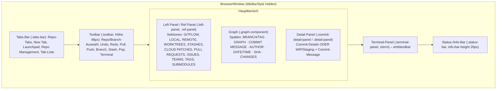
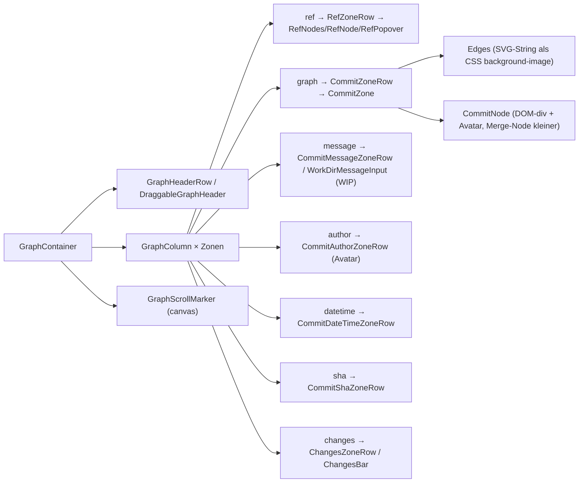
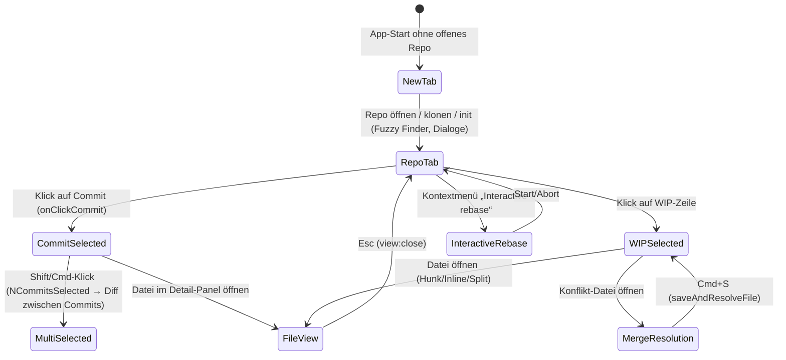

# 05 – UI-Komponenten, Layout und Themes

> Analysegegenstand: GitKraken Desktop **12.5.0** (macOS arm64), statische Analyse einer Kopie unter
> `.work/app` (entpacktes `app.asar`). GitKraken wurde **nicht gestartet**; es gibt keine Screenshots.
> Alle Pfade relativ zu `.work/app/`. Offsets sind Byte-Offsets in einzeiligen, minifizierten Bundles
> (`R` = `src/render/static/entryPoints/main/render.bundle.js`, `M` = `src/main/static/main.bundle.js`,
> `GC` = `node_modules/@gitkraken/gitkraken-components/dist/index.js`).
>
> Legende: **[nachgewiesen]** = direkt im Artefakt gelesen · **[plausibel]** = aus mehreren Indizien geschlossen ·
> **[unbekannt]** = statisch nicht klärbar.

## 1. UI-Technologie-Stack

| Baustein | Befund | Status | Fundstelle |
|---|---|---|---|
| UI-Framework | React 17.0.2, Redux 4.0.4 + redux-saga, zusätzlich Jotai (`jotai-immer`, `jotai-effect`) | [nachgewiesen] | `node_modules/react/package.json`, `package.json` dependencies |
| Root-Mount | `<section id="gitkraken-app">` + Portal-Target `#react-select-portal-target` | [nachgewiesen] | `src/render/static/entryPoints/main/index.html` |
| CSS-Basis | Bootstrap 3-CSS, Basscss (Utility-Klassen wie `flex`, `pt3`, `absolute`), eigenes `src/css/styles.css` (554 KB), `gk-ui-kit.css`, `gitkraken-components/dist/styles.css` | [nachgewiesen] | `index.html` `<link>`-Liste |
| Design-System | `@axosoft/gk-ui-kit` – Komponenten mit `displayName` `Modal`, `ModalHeader`, `ModalBody`, `ModalFooter`, `Button`, `IconButton`, `Select`, `Toggle`, `Checkbox`, `TextArea`, `Kbd`, `ScrollArea`, `Collapsible`, `ToggleGroup`, `SplitButton`, `Separator` u. a. | [nachgewiesen] | `R`, Regex `displayName="…"` |
| Primitive dahinter | `DismissableLayer`, `FocusScope`, `Presence`, `VisuallyHidden`, `SelectContentImpl`, `SelectPopperPosition` → Radix-UI-artige Primitive | [plausibel] | `R`, displayNames |
| Ältere Modals | `.modal`, `.modal-dialog`, `.modal-content` (247/188/213 Selektoren) → react-bootstrap-Modals parallel zum UI-Kit | [plausibel] | `src/css/styles.css`; `react-bootstrap` in deps |
| Graph | `@gitkraken/gitkraken-components` 11.2.1 („React components shared between the app and GitLens“) | [nachgewiesen] | `.../gitkraken-components/package.json` |
| Listen-Virtualisierung | `@axosoft/react-virtualized` (`AutoSizer` 36×, `ReactVirtualized__Grid`), `react-infinite-scroll-component` | [nachgewiesen] | `R`, `GC` |
| Editor/Diff | Monaco (`src/render/static/monaco/monaco.js`, per `<script>` geladen), `getMonaco().editor.createDiffEditor(...)` | [nachgewiesen] | `R@11522602` |
| Terminal | `@xterm/xterm` + `FitAddon`, `WebglAddon`, `WebLinksAddon`; Pseudo-TTY via `node-pty` | [nachgewiesen] | `R@2702720` (`buildTerminal=Ve=>new mn.Terminal(Ve)`) |
| Drag & Drop | `react-dnd` (HTML5-Backend), `@dnd-kit/*`, `react-sortable-hoc` | [nachgewiesen] | deps; `R@842126` (dnd-kit `style.setProperty`) |
| Toasts | `react-hot-toast` | [nachgewiesen] | deps |
| Icons | FontAwesome Pro (proprietär lizenziert), Material Design Iconic Font, eigene `Gk*Icon`-Komponenten | [nachgewiesen] | deps, displayNames – **nicht übernehmen** |
| Klassennamen von App-Komponenten | Minifiziert (`class Ep extends va().Component`) – Komponenten-Namen der App selbst sind **nicht** erhalten; Namen nur über Saga-/Action-Namen, CSS-Klassen und i18n-Keys rekonstruierbar | [nachgewiesen] | `R`, Regex `class X extends …Component` liefert nur `Wn Hn Dr …` |

## 2. Fensteraufteilung und Layout

### 2.1 Fenster
- Hauptfenster: Titel `"GitKraken Desktop"`, `minWidth:950`, `minHeight:675`, auf macOS `titleBarStyle:"hidden"` (eigene Toolbar statt nativer Titelleiste). **[nachgewiesen]** `src/main/static/919.main.bundle.js` (`title:"GitKraken Desktop",…"darwin"===process.platform…titleBarStyle:"hidden"`)
- Default-Größe `DEFAULT_APP_WINDOW_DIMENSIONS={width:1251,height:800}`, letzte Größe aus `windowSettings`. **[nachgewiesen]** `M` (`ie.DEFAULT_APP_WINDOW_DIMENSIONS`), `919.main.bundle.js` (`o?.windowSettings?.height||a`)
- macOS-Ampel-Buttons werden je Zoomfaktor neu positioniert (`DARWIN_WINDOW_BUTTON_POSITIONS_BY_ZOOM_FACTOR`, z. B. `1:{x:8,y:14}`, `2:{x:68,y:35}`) und die Toolbar links gepolstert (`DARWIN_TOOLBAR_PADDING_LEFT_BY_ZOOM_FACTOR`, 65 px bei ≥1, 75/80 px bei 0.9/0.8). **[nachgewiesen]** `R@5486183`

### 2.2 Bereiche (Regionen)



| Region | Befund | Status | Fundstelle |
|---|---|---|---|
| Tabs-Bar | i18n `TabsBar-NewTabTitle`, `TabsBar-FocusViewTitle=Launchpad`, `TabsBar-RepoManagementIconTooltip`, `TabsBar-TabsList`, `TabsBar-ClosedRecently`; CSS `.tabs-bar`, `.tab`, `.tab-group`, `.repo-tab`; eigene Theme-Sektion `tabsbar` | [nachgewiesen] | `src/strings/en-us.json`, `src/css/styles.css`, Themes |
| Tab-Gruppen | Kontextmenü `CloseGroup`, `CloseOthersInGroup`, Preference `AutogroupWorktreeTabs` | [nachgewiesen] | `en-us.json` |
| Toolbar | Labels `Undo`, `Redo`, `Pull`, `Push`, `Branch`, `Stash`, `Pop`, `Cli=Terminal`, `ToolbarLabels-Fetch`; CSS `.toolbar-button`, `.toolbar-button-caption`; Token `toolbar-height = 48px`; Preference `ShowToolbarLabels` | [nachgewiesen] | `en-us.json`, `themeBases/base.jsonc` |
| Pull-Varianten im Toolbar-Dropdown | `Toolbar-PullMerge…`, `Toolbar-PullFastForwardOnly…`, `Toolbar-PullRebase…` | [nachgewiesen] | `en-us.json` |
| Left Panel – Sektionsreihenfolge | `ORDERED_LEFT_PANEL_HEADER_KEYS=[GITFLOW, LOCAL, REMOTE, WORKTREES, STASHES, CLOUD_PATCHES, PULL_REQUESTS, ISSUES, TEAM_VISIBILITY, TAGS, SUBMODULES]` | [nachgewiesen] | `R@6338317` |
| Left Panel – Maße | `HEADER_HEIGHT=30`, `REF_HEIGHT=24`, `SECTION_DEFAULT_HEIGHT=132`, `SECTION_MINIMUM_HEIGHT=108`; Token `left-panel-header-height = 60px` | [nachgewiesen] | `R` (gleiche Konstantengruppe), `base.jsonc` |
| Left Panel – Filter | `LeftPanel-FilterCommits=Filter ({0} + {1} + f)`, Tastenkürzel `command-alt-f → leftPanel:focusFilter`; nicht filterbar: `UNFILTERABLE_SECTION_KEYS={PULL_REQUESTS, ISSUES}` | [nachgewiesen] | `en-us.json`, `keyBindings/shared.json`, `R@6338317` |
| Left Panel – Sichtbarkeit pro Ref | `LeftPanel-Hide/Show=Hide/Show in graph`, `StopSoloing`; Sagas `toggleSoloedSaga`, `updateRefIsHiddenSaga`, `setPinnedBranchFullNameSaga` | [nachgewiesen] | `en-us.json`, `.work/git-ops.txt` |
| Left Panel – Ein-/Ausklappen & Breite | `refPanelOpen`, `refPanelWidth`; eingeklappt ≈ 35 px Rail (`left:mn?gn-Wn-10:35-Wn-10`), Animation über `react-motion` `spring(...)` | [nachgewiesen] (Werte) / [plausibel] (35 px = Rail-Breite) | `R@6658499` |
| Graph (Mitte) | `.graph-component`, Header-Spalten s. §3 | [nachgewiesen] | `keyBindings/shared.json`, `en-us.json` `GraphHeader-*` |
| Rechtes Panel | `RightPanel-*`, `CommitDetailPanel-*` (Tabs `Commit`, `Stash`, `Cloud Patch`, `Code Suggest`), Diff-Vergleich mehrerer Commits (`DiffBetweenTwoCommits`, `NCommitsSelected`) | [nachgewiesen] | `en-us.json` |
| Terminal-Panel | `.terminal-panel`, `.terminal-toolbar`, Menüeintrag `ShowTerminalPanel`, Theme-Tokens `terminal__*` (16 ANSI-Farben) | [nachgewiesen] | CSS, `menuStrings`, Themes |
| Datei-/Diff-Ansicht | `FileViewPanel-*`, `fileViewMode`, `fileDisplayModes={CONTENT,HUNK,INLINE,SPLIT}` | [nachgewiesen] | `R@8743632`, `R@2165571` |
| Ort der Datei-Ansicht | Datei-Diff ersetzt beim Öffnen den Graph-Bereich (Graph ↔ File View) | [plausibel] | Saga-Namen `openFileWithoutDiffSaga`, `reOpenFileWithoutDiffSaga`; kein Runtime-Beleg |
| Merge-Konflikt-Editor | `.merge-resolution-panel` (150 Selektoren), `.diff3-*` (A/B/Output-Kacheln), Shortcut `command-s → mergeResolution:saveAndResolveFile` | [nachgewiesen] | CSS, `keyBindings/shared.json` |
| Status-/Info-Bar | `.status-bar`, `info-bar-height = 26px`; Inhalte u. a. Abo-/Trial-Hinweise (`StatusBar-*`) | [nachgewiesen] | CSS, `base.jsonc`, `en-us.json` |
| Panel-Resize | `.resizable`, `.resizable-handle`, `handle-width = 7px`, `re-resizable` + `components/resizable/Resizable` im Graph-Paket, `LeftPanelToGraphMarginGap = 7`, `ResizableHandleCorrection = 4` | [nachgewiesen] | CSS, `base.jsonc`, `GC` `GraphConstants.d.ts` |

## 3. Commit-Graph-Darstellung

Quelle: Typdefinitionen und Code in `node_modules/@gitkraken/gitkraken-components/dist/` (`*.d.ts` sind unminifiziert).

### 3.1 Struktur
Komponentendateien **[nachgewiesen]** (`components/graph/`): `GraphContainer`, `GraphColumn`, `GraphHeaderRow`, `GraphScrollMarker`; Zeilen-Renderer `RefZoneRow`, `CommitZoneRow`, `CommitMessageZoneRow`, `CommitAuthorZoneRow`, `CommitDateTimeZoneRow`, `CommitShaZoneRow`, `ChangesZoneRow`, `CommitsInfoRow`, `TimelineMsgRow`; Commit-Zone `CommitZone`, `CommitNode`, `Gutter`, `BackgroundStreak`, `GraphAvatar`; Kanten `edges/Edges`, `EdgeNodes`, `Arc`, `StartingEdge`, `EndingEdge`, `PassThroughEdge`; Ref-Zone `RefZone`, `RefNodes`, `RefNode`, `RefName`, `RefPopover`, `CreateRefNode`, `FloatingCreateRefNode`, `OverflowCount`; WIP-Zeile `messagezone/WorkDirMessageInput`, `shared/InlineWorkDirSummary`; Changes-Spalte `changeszone/ChangesBar`.



### 3.2 Spalten (Zonen)
- Zonen-Typen: `'ref' | 'graph' | 'message' | 'author' | 'datetime' | 'sha' | 'changes'`. **[nachgewiesen]** `domain/graph/GraphConstants.d.ts`
- Header-Texte: `BRANCH / TAG`, `GRAPH`, `COMMIT MESSAGE`, `AUTHOR`, `COMMIT DATE / TIME`, `SHA`, `CHANGES`; „Column settings“, „Hidden Branches / Tags“. **[nachgewiesen]** `en-us.json` `GraphHeader-*`
- Spaltenmodi `GraphColumnMode { Compact, Rich, Text }`; Preferences „Show commit message/description/tree/author/changes/date/sha in graph“, „Compact graph column layout“, Reset auf Default/Compact. **[nachgewiesen]** `GraphConstants.d.ts`, `en-us.json` `UIPreferences-*`
- Mindestbreiten: ref 32, author 32, datetime/sha/message/changes 50, Commit-Zone-Viewport min 56; Breite, unter der nur ein Icon gezeigt wird: ~50–58 px. **[nachgewiesen]** `GraphConstants.d.ts`
- Standard-SHA-Länge 6, `numGraphColumnsDefault = 10`, max. 100 gerenderte Refs pro Zeile. **[nachgewiesen]** `GraphConstants.d.ts`

### 3.3 Maße
| Konstante | Wert | Fundstelle |
|---|---|---|
| `GRAPH_ROW_HEIGHT` / `COMMIT_ZONE_ROW_HEIGHT` | 28 | `GraphConstants.d.ts` |
| `GRAPH_ROW_INNER_HEIGHT` | 22 | ebd. (Theme-Token `graph-row-height = 22px`) |
| `GRAPH_HEADER_ROW_HEIGHT` | 26 | ebd. |
| `COMMIT_AUTHOR_ZONE_AVATAR_OUTER_DIAMETER` | 22 | ebd. |
| `REF_ZONE_TEXT_HEIGHT` / `REF_NODE_ICON_WIDTH` | 18 / 14 | ebd. |
| Rich-Modus: Spaltenbreite / Linienbreite / Gutter | 22 / 2 / 28 | `GC@345947` (`t?10:22`, `t?1:2`, `t?10:28`) |
| Compact-Modus: Spaltenbreite / Linienbreite / Gutter | 10 / 1 / 10 | ebd. |
| Merge-Node-Durchmesser (Rich) | `s/2+1` = 12 | ebd. |
| Lane-x-Position | `gutter + column*colWidth + colWidth/2` | `GC@16267` (`o+e*t+t/2`) |

**[nachgewiesen]** für alle Zeilen der Tabelle.

### 3.4 Rendering-Technik
- **Kanten:** pro Zeile wird ein SVG-String aus `<line>`/Bogen-Pfaden gebaut und als `background-image: url('data:image/svg+xml;…<svg …>')` gesetzt; Ergebnisse werden per Schlüssel (Spalte, Kantentyp, compact) gecacht. Gestrichelte Linien (`strokeDasharray`) für bestimmte Commit-Typen. **[nachgewiesen]** `GC@16602` (`function eh(e){return el("line",e)}`), `GC@251812` (`url('data:image/svg+xml;charset=UTF-8,<svg …`)
- **Knoten:** DOM-`div` (`className:"node"`, Höhe/Breite = `COMMIT_NODE_DIAMETER`) mit Avatar; WIP-Knoten mit gestricheltem, ggf. rotierendem SVG-Kreis (`animation:"wip-border-spin …"`). **[nachgewiesen]** `GC@248106`, `GC@248349`
- **Avatare:** werden über ein verstecktes `<canvas id="gk-graph-avatar-canvas">` in Data-URLs umgewandelt und gecacht. **[nachgewiesen]** `GC@203593`, `GC@204223`
- **Scroll-Marker:** eigenes `<canvas className="graph-scroll-markers">` neben der Scrollbar; Marker-Typen `head, highlights, localBranches, pullRequests, remoteBranches, selection, stashes, tags, upstream`, Formen `block/fullLine/thinLine`, 3 Lanes. **[nachgewiesen]** `GC@153120`, `GC@153884`, `GraphConstants.d.ts`
- **Virtualisierung:** Zeilen über react-virtualized (`overscanRowCount:10`), Lazy-Loading weiterer Commits (`GRAPH_ROW_LAZY_LOAD_COMMITS_OFFSET`, `SHOW_MORE_COMMITS`-Zeile). **[nachgewiesen]** `GC` (`overscanRowCount:10`, `"SHOW_MORE_COMMITS"`)
- **Hover/Selektion:** Container-Klasse in der App hält `selectedShas`, `processedGraphRowBySha`, `shaByRefId`, `childrenBySha`, `lastTopVisibleRowIndex` u. a. **[nachgewiesen]** `R@11367226`
- **Lane-Farben:** Theme-Tokens `graph-color-0` … `graph-color-9` (10 Farben, identisch in allen Default-Themes); `columnColorByColumn` ordnet Spalten Farben zu. **[nachgewiesen]** Themes, `CommitZone.d.ts`
- Wie Spalten den Branches zugewiesen werden (Lane-Algorithmus) – **[unbekannt]** im Detail; Eingaben sind `RowEdges` mit `starting/ending/passThrough` je Spalte (`GC@250079`). Das Graph-Layout wird vermutlich außerhalb der Komponente berechnet (s. `04-git-integration.md`). **[plausibel]**

## 4. Theme-System

### 4.1 Dateien und Pipeline
- Default-Themes: `src/main/static/defaultThemes/{dark,light,dark-high-contrast,light-high-contrast,light-legacy,light-high-contrast-legacy}.jsonc-default`; zusätzlich `celestialThemes/celestial-dark.jsonc`; Basiswerte `themeBases/base.jsonc` (358 Keys). **[nachgewiesen]**
- Benutzer-Themes: Erweiterungen `.json`/`.jsonc` (`EXTERNAL_THEME_EXTENSIONS`), Blacklist `__proto__`, `constructor`. **[nachgewiesen]** `M@6784481`
- Format: `{ meta: { name, scheme: "dark"|"light" }, themeValues: { root:{…}, toolbar:{…}, tabsbar:{…} } }`. Werte dürfen Less-ähnliche Funktionen nutzen: `lighten()`, `darken()`, `saturate()`, `fade()` und Referenzen `@token`. **[nachgewiesen]** Themes
- Kompilierung im **Main-Prozess**: `compileTheme` liest JSONC (`jsonc-parser`), merged Default-Theme des Schemas mit Benutzerwerten (`{...ae.root,...ge.themeValues.root}`) und wertet mit `evaluateThemeObjectToColors` zu Farben aus; setzt `nativeTheme.themeSource`. **[nachgewiesen]** `M@3595697`
- Anwendung im Renderer als CSS-Custom-Properties (`var(--text-normal)` in Theme-Werten, `CssVariables`-Props in Graph-Komponenten). **[plausibel]** – Ort des `setProperty` für Theme-Variablen nicht gefunden.

### 4.2 Token-Gruppen (Auszug `dark` root, 171 Keys)
Farben `white, black, red, orange, yellow, green, teal, blue, ltblue, purple` · Hintergründe `app__bg0, toolbar__bg0-2, panel__bg0-2, glass*, input__bg, card__bg` · Rahmen `panel-border, section-border, subtle-border` · Text `text-selected, text-normal, text-secondary, text-disabled, text-accent, text-inverse, text-bright, text-dimmed` · Buttons `default|primary|success|warning|danger-{border,bg,hover}` · Zeilen `hover-row, selected-row, warning-row, danger-row, drop-target` · Graph `graph-color-0..9, wip-status, checked-out, filter-match` · Diff `added-line, deleted-line, modified-line, stats-*` · Konflikt `conflict-{left,right,output}-{color,border-color}` · Terminal `terminal__*` (16 ANSI + Cursor/Selection) · Code `code-bg, code-foreground, code-blame-color-0..9` · PR `pull-request-{open,draft,merged}-color`. **[nachgewiesen]** `defaultThemes/dark.jsonc-default`

### 4.3 Kernfarben der Themes

| Theme (`meta.name`) | scheme | `app__bg0` | `panel__bg0` | `toolbar__bg0` | Text | `text-accent` | `panel-accent` |
|---|---|---|---|---|---|---|---|
| Dark | dark | `#1C1E23` | `lighten(app,5%)` | `lighten(saturate(app,3%),6%)` | `#FFFFFF` @75 % | `#93A9EC` | `#BC7EFF` |
| Dark – High Contrast | dark | `#090A0B` | wie Dark | wie Dark | `#FFFFFF` @78 % | `#93A9EC` | `#BC7EFF` |
| Light | light | `#fcfcfc` | `#F3F3F3` | `#FAFAFA` | black @75 % | `#395BBF` | `#7600F6` |
| Light – High Contrast | light | `#fcfcfc` | `#F3F3F3` | `#FAFAFA` | `#000000e5` | `#395BBF` | `#7600F6` |
| Light (legacy) | light | `#FFFFFF` | `#fafafa` | `#3E455E` | `#000000` @90 % | `#395BBF` | `#7600F6` |
| Light HC (legacy) | light | `#FFFFFF` | `#FAFAFA` | `#242937` | `#000000` @90 % | `#395BBF` | `#7600F6` |
| Celestial Dark | dark | `#1C1E23` | wie Dark | wie Dark | `#FFFFFF` @75 % | `#93A9EC` | `#BC7EFF` |

Statusfarben (Dark): red `#D9413D`, green `#5CB85C`, blue `#4D88FF`, orange `#DE9B43`, yellow `#ECB91C`.
Graph-Lanes (alle Themes): `#15a0bf #0669f7 #8e00c2 #c517b6 #d90171 #cd0101 #f25d2e #f2ca33 #7bd938 #2ece9d`. **[nachgewiesen]** (geparst mit `jsonc-parser`)

> Hinweis für die Eigenentwicklung: Farbwerte sind Fakten, aber eine eigene Palette ist sinnvoll, um keine
> Corporate-Identity nachzubilden.

## 5. Abstände, Typografie, Zoom

- Root-Font-Size `62.5%` (→ 1 rem = 10 px), Skala `fs-1…fs-7 = 1, 1.2, 1.4, 1.6, 1.8, 2, 2.4 rem`. **[nachgewiesen]** `base.jsonc`
- Schrift UI: `'Open Sans', Arial, sans-serif`; Mono: `Monaco, Menlo, Ubuntu Mono, Consolas, source-code-pro, monospace`. **[nachgewiesen]** `base.jsonc`
- Buttons: Padding xs `.15/.5rem` bis large `1/1.25rem`, Radius `.2rem`; Input-Radius `3px`. **[nachgewiesen]** `base.jsonc`
- Feste Höhen: Toolbar 48 px, Left-Panel-Header 60 px, Info-Bar 26 px, File-History-Header 35 px, Resize-Handle 7 px. **[nachgewiesen]** `base.jsonc`
- Zoom: `ZOOM_FACTORS=[3,2.5,2,1.75,1.5,1.4,1.3,1.2,1.1,1,.9,.8]`, `DEFAULT_ZOOM_FACTOR=1`; Start-Zoom via `webFrame.setZoomFactor` in `setStartupZoomSaga`; Menü `ZoomIn (Cmd+=)`, `ZoomOut (Cmd+-)`, `ZoomReset (Cmd+0)`. **[nachgewiesen]** `R@5486183`, `R@1985489`, `src/main/static/977.main.bundle.js`
- Zusätzlich separate Font-Size-/Line-Height-Einstellungen (`setFontSizeSettingSaga`, `setLineHeightSettingSaga`) – wirken vermutlich auf Editor/Diff/Terminal. **[plausibel]** `.work/git-ops.txt`

## 6. Scroll- und Virtualisierungsverhalten
- Graph: react-virtualized-Grid, Overscan 10 Zeilen, Nachladen am Ende, `scrollToAlignment` `auto|center` (Springen zu Commit/Pinned Branch: `Graph-JumpToPinnedBranch`). **[nachgewiesen]** `GraphConstants.d.ts`, `en-us.json`
- Synchrones horizontales Scrollen der Commit-Zone über `scrollLeft`-Prop und Gutter-Schatten (`leftGutterBoxShadowAlpha`). **[nachgewiesen]** `CommitZone.d.ts`
- Eigene Scrollbar-Komponente `common/ScrollbarContainer`, Theme-Tokens `scroll-thumb-*`. **[nachgewiesen]**
- Listen im Left Panel und Datei-Listen: react-virtualized `AutoSizer`/List. **[plausibel]** (AutoSizer 36× im Renderer, konkrete Zuordnung nicht verifiziert)

## 7. Dialoge, Modals, Popover, Toasts
- Modals: gk-ui-kit `Modal` (+ `ModalTrigger/Header/Title/Description/Body/Footer/Close`) und Bootstrap-Modals (`.modal-dialog`). Overlay-Farbe `modal-overlay-color: rgba(0,0,0,.5)`. **[nachgewiesen]** displayNames, CSS, Theme
- Bekannte Dialog-Typen (aus i18n-Präfixen, Anzahl Strings): `CloneRepo` (17), `InitRepo` (18), `OpenRepo` (20), `RepoManagement` (50), `RemoteForm` (28), `PromptForCreds` (27), `ConfirmationMessage` (37), `FocusViewItemActionModal` (41), `AddEditWorkspace` (53), Preferences-Seiten (`GeneralPreferences`, `UIPreferences`, `ToolPreferences`, `GPGPreferences`, `CLIPreferences`, `ExperimentalPreferences`, `GKAIPreferences`, `ConflictDetectionPreferences`). **[nachgewiesen]** `en-us.json`
- Popover: `RefPopover` (Graph), `commit-popover`, `conflict-detection-popover`, react-bootstrap `PopoverHeader/PopoverBody`. **[nachgewiesen]**
- Toasts: `react-hot-toast`; Sagas `showPushSuccessToastSaga`, `showPushFailureToastSaga`, `showBranchesDeletedToastSaga`. **[nachgewiesen]**
- Fuzzy Finder / Command Palette: `FuzzyFinder*` (242 Treffer), Domänen (`FuzzyFinderForDomain`, `OpenRepo`, `History`), **Frecency**-Ranking (`FuzzyFinderFrecencyItemMetadata`), Fuzzy-Matching via `fuzzaldrin-plus`. Öffnen mit `Cmd+Shift+P` („Toggle Command Palette“), Repo öffnen `Cmd+Shift+O`, Datei-Historie `Cmd+Shift+H`. **[nachgewiesen]** `R`, `keyBindings/shared.json`, `en-us.json`, deps

## 8. Kontextmenüs (nativ, über IPC)
Ablauf **[nachgewiesen]**:
1. Renderer baut Menübeschreibung, macht sie serialisierbar (`makeMenuSerializable`), merkt sich Click-Handler lokal (`_clickHandlers`, `_currentMenuId`) und sendet IPC `POPUP_MENU` (`contextMenuIpcMessageChannels={POPUP_MENU:"POPUP_MENU"}`). `R@48229`, `R@7676194`
2. Main registriert `{message: POPUP_MENU, sagaFn: popupMenu, preserveSender: true}`, rekonstruiert das Menü (`reconstructMenu`), ruft `Menu.buildFromTemplate` + `menu.popup(window)` und sendet bei `menu-will-close` `"context-menu-close"` zurück. `src/main/static/57.main.bundle.js@123733`, `@16821`
3. Klick → Renderer-Saga `handleContextMenuItemAction(menuId, itemId)` führt den gespeicherten Handler aus. `R@48229`

Menüeinträge (175 `ContextMenu-*`-Strings, Auswahl): Checkout, Create branch/tag here, Cherry-pick, Rebase onto / interactive rebase, Merge into, Reset soft/mixed/hard, Revert, Reword/Amend, Squash, Drop, Move commit up/down, Push to…, Set upstream, Rename/Delete branch, Pin branch to left, Solo/Hide, Stash apply/pop/delete, Copy SHA/branch/path, Compare against working copy, Restore file from commit, Create worktree, Close tab(s). **[nachgewiesen]** `en-us.json`

## 9. Tastenkürzel

### 9.1 In-App-Keymap (`src/keyBindings/*.json`, Atom-Keymap-Format via `@axosoft/atom-keymap`) **[nachgewiesen]**
`command` = Cmd auf macOS (auf Win/Linux Strg – **[plausibel]**, Mapping nicht verifiziert).

| Taste | Befehl | Kontext |
|---|---|---|
| Cmd+B | `repo:createBranch` | body |
| Cmd+/ | `view:toggleKeyBindings` | body |
| Cmd+\\ | `view:toggleRefPanelDeprecatedKeybinding` | body |
| Cmd+D | `select:openSelectedFileInExternalFileCompareTool` | body |
| Cmd+F | `view:focusModalSearchOrOpenCommitSearch` | body |
| Cmd+Shift+O | `view:toggleFuzzyFinderOpenRepo` | body |
| Cmd+Alt+F | `leftPanel:focusFilter` | body |
| Cmd+Shift+P | `view:toggleFuzzyFinder` | body |
| Cmd+Y / Cmd+Shift+Z | `core:redo` | body |
| Cmd+Z | `core:undo` | body |
| ↑ / K | `select:previous` | body |
| ↓ / J | `select:next` | body |
| Shift+↑ / Shift+K | `select:previousTopological` | body |
| Shift+↓ / Shift+J | `select:nextTopological` | body |
| ← / H | `select:left` | body |
| → / L | `select:right` | body |
| D / P / R | `interactiveRebase:dropCommit` / `pickCommit` / `rewordCommit` | body |
| S | `shared:s` (Stage aktuelle Datei, kontextabhängig) | body |
| U | `repo:unstage` | body |
| Cmd+Shift+S | `repo:stageAll` | body |
| Cmd+Shift+U | `repo:unstageAll` | body |
| Cmd+Shift+M | `workDir:focusCommitMessage` | body |
| Cmd+Shift+H | `view:toggleFuzzyFinderHistory` | body |
| Cmd+L | `repo:fetch` | body |
| Cmd+Shift+T | `view:reopenTab` | body |
| Cmd+J | `view:toggleRefPanel` | body |
| Cmd+K | `view:toggleDetailPanel` | body |
| Cmd+S | `mergeResolution:saveAndResolveFile` | body |
| Esc | `view:close` | body |
| Ctrl+Alt+Shift+I | `dev:devTools` | body |
| Cmd+Enter | `commit:commit` | Commit-Message-Input |
| Cmd+Shift+Enter | `commit:commitAll` (Stage all + Commit) | Commit-Message-Input |
| Cmd+Enter / Cmd+Shift+Enter | `native!` (durchgereicht) | Reword-Eingabe |
| Cmd+Home/End, Cmd+↑/↓ | `select:first/last`, `shared:commandUp/Down` | `.graph-component` bzw. plattformspezifisch (`darwin.json`, `linux.json`, `win32.json`) |

### 9.2 Native Menü-Accelerators (macOS, `src/main/static/977.main.bundle.js`) **[nachgewiesen]**
`Cmd+,` Preferences · `Cmd+=`/`Cmd+-`/`Cmd+0` Zoom · `Cmd+1…9` Tab 1–9 · `Cmd+Ctrl+1…9` Favorit 1–9 · `Cmd+Ctrl+F` Vollbild · `Cmd+/` Keyboard Shortcuts · `Alt+Cmd+I` DevTools · `Alt+T` externes Terminal · `Alt+O` im Dateimanager öffnen. Weitere Einträge (NewTab, CloseTab, Clone/Init/Open Repo, Show Left/Detail/Terminal Panel, OpenFuzzyFinder, Next/Prev Tab, OpenTabsList) haben Accelerators, deren Tastenfolge statisch nicht eindeutig zuordenbar war. **[unbekannt]** (Text-Hinweise: `TabsBar-NewTabDescription={0} + T`, `TabsBar-TabsList=Tabs list ({0} + Shift + A)`)

## 10. Zustandsübergänge (UI)


**[plausibel]** – Zustände und Übergänge sind aus Saga-/Action-Namen (`selectCommitSaga`, `openInteractiveRebaseToolSaga`, `mergeResolveSaga`), i18n-Keys und Keymap abgeleitet, nicht zur Laufzeit beobachtet.

## 11. Vorschlag: eigenständige Vue-3-Komponentenarchitektur

> **Vorschlag** (eigene Architektur, keine Übernahme von Code, Marken, Icons oder CSS).
> Funktional vergleichbar, technisch bewusst anders (z. B. Canvas statt DOM für den Graph).

```mermaid
flowchart TB
  App[App.vue] --> TitleBar[TitleBar + TabStrip]
  App --> Workspace[RepoWorkspace.vue]
  App --> Overlays[OverlayHost: Dialogs, Palette, Toasts]
  Workspace --> TB[RepoToolbar]
  Workspace --> Split[SplitLayout (resizable, persistiert)]
  Split --> Side[Sidebar]
  Side --> SideSec["SidebarSection × n (Branches, Remotes, Tags, Stashes, Worktrees, Submodules)"]
  Split --> Main[MainArea]
  Main --> Graph[CommitGraph]
  Graph --> GCanvas["GraphCanvas (Canvas 2D: Lanes + Knoten)"]
  Graph --> GRows["VirtualRows (DOM: Refs, Message, Author, Date, SHA)"]
  Main --> DiffView["DiffView (Monaco, Modi: hunk/inline/split)"]
  Main --> Conflict["ConflictEditor (3-Wege)"]
  Split --> Detail[DetailPanel]
  Detail --> CommitInfo[CommitInfo]
  Detail --> Staging["StagingPanel + CommitComposer"]
  Workspace --> Term["TerminalDock (xterm.js + node-pty)"]
  Workspace --> Status[StatusBar]
```

Kernelemente:
- **Layout:** `SplitLayout` mit CSS-Grid und eigenen Drag-Handles; Größen pro Repo in Pinia `layoutStore` persistiert. Sidebar einklappbar auf eine Icon-Rail.
- **Graph:** Lanes und Knoten auf **einem Canvas pro Viewport** (DevicePixelRatio-bewusst), Textspalten als virtualisierte DOM-Zeilen (`@tanstack/vue-virtual` o. ä.) mit gemeinsamer Zeilenhöhe (z. B. 28 px). Lane-Zuweisung im Worker/Main (s. `08-implementation-plan.md`). Spalten konfigurierbar (sichtbar/Breite/Reihenfolge), Compact/Rich-Modus.
- **Theming:** Design-Tokens als CSS-Custom-Properties (`--bg-app`, `--text-primary`, `--lane-0..9` …), Themes als JSON, kompiliert mit einer kleinen Farbfunktion-Bibliothek (lighten/darken/alpha) – eigenes Token-Schema und eigene Palette.
- **Kommandos:** zentrale `commandRegistry` (id → handler, when-Kontext), daraus speisen sich Keymap, native Menüs, Kontextmenüs und Command Palette (Fuzzy + Frecency).
- **Kontextmenüs:** nativ über IPC (`menu:popup` mit serialisierbarer Beschreibung, Click-Rückmeldung per ID) – gleiches Muster ist bewährt; mit `contextIsolation:true` + Preload statt `nodeIntegration`.
- **Dialoge:** ein `OverlayHost` mit Stack (Dialog, Palette, Confirm), Fokus-Trap und Esc-Handling; Toasts als eigene Queue.
- **Zoom:** `webFrame.setZoomFactor` mit fester Stufenliste; Toolbar-Inset für macOS-Ampel über `titleBarOverlay`/`trafficLightPosition` statt manueller Positionstabelle.

## 12. Offene Fragen (UI)
1. **Screenshots / Laufzeitbeobachtung fehlen** – Runtime-Capture (z. B. REA `capture_electron_scenario`) wurde bewusst zurückgestellt, da es die echte App mit den Repos/Accounts des Users starten würde. Benötigt Freigabe und ein Test-Repo ohne private Inhalte.
2. Genaue Pixel-Layouts (Default-Breiten Left/Right Panel) – Breiten liegen im Redux-State/Settings, Default-Werte nicht gefunden. **[unbekannt]**
3. Ort und Mechanismus, an dem kompilierte Theme-Farben als CSS-Variablen in den Renderer injiziert werden. **[unbekannt]**
4. Tastenfolgen einiger Menü-Accelerators (Tabs, Panels, Fuzzy Finder) – statisch nicht eindeutig zuordenbar. **[unbekannt]**
5. Lane-Zuweisungsalgorithmus des Graphen (wo berechnet: Renderer, Worker oder Rust-Bridge). **[unbekannt]** → siehe `04-git-integration.md`.
