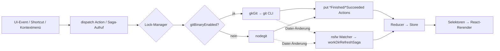

# 06 – Funktionsanalyse

Grundlage ist dieselbe statische Analyse wie in [04-git-integration.md](04-git-integration.md). Legende, Fundstellen-Kürzel (`R`, `W`, `M57`, `U`) und Byte-Offset-Konvention stehen dort.

**Methodik**
- Redux-Actions folgen dem Muster `function Name(…){return{type:Name,…}}`. 708 solcher Action-Creator wurden nach `.work/actions.txt` extrahiert.
- Sagas: benannte Generatoren `function*xyzSaga`. 1906 stehen in `.work/render-generators.txt`, 253 davon mit `{locks, saga}` in `.work/git-ops.txt`.
- **[unbekannt] allgemein:** Welche React-Komponente welche Saga auslöst, wurde nur für Stichproben verfolgt. Die UI-Einstiege sind daher meist **[plausibel]** und werden in 05-ui-components.md vertieft. Laufzeit-Beobachtung fand nicht statt.

**Gemeinsame Muster** (gelten für alle Funktionen):
- **Fehlerbehandlung [nachgewiesen]**: Konstante Fehlercodes wie `REPO_CHANGED`, `MUST_HAVE_REPO`, `MUST_HAVE_CHECKED_OUT_BRANCH`, `NO_MERGE_IN_PROGRESS`, `UNRESOLVED_CONFLICTS`, `CANNOT_COMMIT_WITHOUT_STAGED_FILES`. Saga-Lifecycle `failed`. git-stderr wird in `GkGitError` übersetzt (`customErrorCallback`, `R@4803020`). Die Anzeige erfolgt per Toast (`showToast`, `showPushFailureToastSaga`).
- **Logging [nachgewiesen]**: Operationen tragen `logging:{name:\`Pull ${ref}\`}` und landen im Activity-Log (`startDefaultLog`, `R@8251257`).
- **Repo-Wechsel-Schutz [nachgewiesen]**: Fast jede Saga beginnt mit `if((yield select(getRepo))!==Ve)throw new Error(REPO_CHANGED)`.
- **Watcher-Pause [nachgewiesen]**: Mutierende Sagas rufen `pauseWorkDirTrigger`/`wrapSagaInPauseWorkDirTrigger` auf.

---

## 1. Repository öffnen und klonen

| Aspekt | Befund |
|---|---|
| UI-Einstieg | **[plausibel]** Repo-Management-Tab, Fuzzy-Finder (`command-shift-o` → `view:toggleFuzzyFinderOpenRepo`, `src/keyBindings/shared.json` **[nachgewiesen]**), Deep-Link `URI_COMMAND_NAME.REPO` (Main-Bundle) |
| Actions **[nachgewiesen]** | `RepoOpenStarted`, `RepoOpened`, `RepoOpenFinished`, `CachedRepoReduxStoreLoaded`, `CloneRepoUrlUpdated`, `CloneRepoPathUpdated`, `CloneRepoNameUpdated`, `CloneRepoHostingServiceUpdated`, `CloneRepoReset`, `CreateRemoteRepoAndCloneStarted/Finished`, `RepoInit*Set` (Init-Formular), `InitRepoWithLfsSet` |
| Sagas **[nachgewiesen]** | Öffnen: Saga bei `R@6974189` (setzt `FetchesReset`, `PushPromiseReset`, prüft `hasReduxCache`, startet AskPass- und Sequence-Editor-Emitter). Klonen: nodegit-Variante `R@5435744` (`Clone.clone(url,path,{checkoutOpts:{disabledFilters:[LFS]},fetchOpts})`), Binary-Variante `R@5439649` (`gkGit.clone` mit `sparseCheckout`, `filter`, `customFlags`, `progress`). `openAfterCloneSaga`, `initRepoSaga` (`R@9519982`, `repoInit` mit Fallback `manuallyInitRepo`), `reopenRepoSaga` |
| Datenfluss | Pfad → `path.resolve` → Redux-Cache-Lookup → `Repository.open` (`R@4567853`) → Watcher-Start → Refresh. **[plausibel]** Ist ein Cache vorhanden und hat die Maschine mehr als 4 CPUs, wird der Cache zuerst angezeigt (`Mr.length>4`, `R@6974189`) |
| IPC **[nachgewiesen]** | `cloneRepoIpcMessageChannels`: `CLONE_REPO_STARTED`, `CLONE_REPO_PROGRESS_UPDATED`, `CLONE_REPO_SUCCEEDED`, `CLONE_REPO_FINISHED`, `UPDATE_CLONE_REPO_URL` (`R@7046511`). Im Main-Bundle tauchen dieselben Namen auf. **[plausibel]** Main leitet Fortschritt an andere Fenster/Tabs weiter |
| Git | nodegit `Clone.clone` / `git clone --progress` (Fortschritt über `makeprogressCloneStderr`), `git init`, Repo-Suche per nativem Modul `findGitRepos.node` |
| Fehler | `LOCAL_PATH_REQUIRED`, `"attempt to reinitialize"` führt zu `manuallyInitRepo` **[nachgewiesen]** |
| State | `repo.path`, Tabs (`tabOperationTypes.CREATE/LOAD_TABS`, `R@7658751`), Session-Cache `sessionRepoReduxStoreCache` |

## 2. Commit-Graph und Branch-Visualisierung

| Aspekt | Befund |
|---|---|
| UI-Einstieg | **[nachgewiesen]** React-Komponente `GraphContainer` aus `@gitkraken/gitkraken-components` 11.2.1 („shared between the app and GitLens“, `package.json`). Zonen: `RefZoneRow`, `CommitZoneRow`, `CommitMessageZoneRow`, `CommitAuthorZoneRow`, `CommitDateTimeZoneRow`, `CommitShaZoneRow`, `ChangesZoneRow` (`dist/components/graph/rowRenderers/*.d.ts`) |
| Datenmodell **[nachgewiesen]** | `GraphRow {sha, parents[], author, email, date, message, type, heads?, remotes?, tags?, contexts?}`. Kanten: `RowEdges {[column]: {starting?, ending?, passThrough?}}` mit `Edge {parentSha, type}` (`dist/domain/graph/GraphTypes.d.ts`). Konstanten: `GRAPH_ROW_HEIGHT = 28`, `COMMIT_ZONE_ROW_INNER_HEIGHT = 22`, `GRAPH_HEADER_ROW_HEIGHT = 26` (`GraphConstants.d.ts`) |
| Actions **[nachgewiesen]** | `InitialCommitWalkStarted/Updated/Finished`, `InitialCommitWalkFnsAdded/Cancelled`, `ColumnsCalculated` (Callback `onColumnsCalculated`, `R@532955`), `CurrentlyHoveredGraphCommitChanged`, `SetGKGraphContainerRef`, `SelectedBranchChanged`, `SelectedBranchCommitChanged` |
| Sagas **[nachgewiesen]** | `fetchCommitsFromRevWalkSaga` (`R@3366405`): `revwalk.reset/sorting/push` → `commitWalk(maxCommitsRetrievedAtOnce,{returnPlainObjects:!0})` in einer Schleife. Ref-Sichtbarkeit: `updateRefIsHiddenSaga`, `updateRefIsSoloedSaga`, `toggleSoloedSaga`, `hideAllTagsSaga`, `hideAllStashesSaga`, `setPinnedBranchFullNameSaga` |
| Konstanten **[nachgewiesen]** | `maxCommitCountDefault=2e3`, `pagedLazyLoadCommitCount=200`, `maxCommitsRetrievedAtOnce=1e5` (`R@10510927`ff.) |
| Spaltenberechnung | **[plausibel]** Die Lane- und Spaltenzuteilung passiert in der Komponente (Helfer `getXValueAtColumn`, `buildEdgeHash`, `buildPassThroughEdgeHash`, `EdgeHelpers.d.ts`). Ergebnis geht per `ColumnsCalculated` zurück an Redux. Den Algorithmus selbst habe ich nicht im Detail gelesen **[unbekannt]** |
| IPC | keine (alles im Renderer) **[plausibel]** |
| Git | nodegit `Revwalk` + `commitWalk` (Axosoft-Erweiterung, siehe 04 §12) |
| State | `commitsBySha`, Selektionen (`getSelectedShas`), `initialCommitWalk*`-Flags |

## 3. Branches erstellen, wechseln, löschen

| Aspekt | Befund |
|---|---|
| UI-Einstieg | **[nachgewiesen]** Shortcut `command-b` → `repo:createBranch`. **[plausibel]** Doppelklick oder Kontextmenü auf Ref (`OnDoubleClickRef`, `OnRefContextMenu`, `OnRefCreate` in GraphContainer-Props), Drag&Drop von Refs (`OnRefDrop`) |
| Actions **[nachgewiesen]** | `CreateBranchFormChanged`, `CreateBranchFormNameReset`, `BranchLoadingStarted/Succeeded/Finished` |
| Sagas **[nachgewiesen]** | Erstellen: `gkGit.createBranch` → `git switch --create` oder `git branch` (`R@7542791`). Wechseln: `checkoutSaga` (`R@8187328`) verzweigt zu `gitCheckout` oder `nodegitCheckout` (`locks:[CONFIG,GITATTRIBUTES,INDEX,REPO_SETTINGS]`). `gitCheckoutAndUpdateHeadSaga` (`R@499755`, `gkGit.checkout`, optional `recurseSubmodules`). `checkoutRefOrOpenWorktreeSaga` (`R@8278627`) öffnet den Worktree, wenn der Branch dort schon ausgecheckt ist. Löschen: `deleteRefBaseSaga` (`R@8225318`, `locks:[CONFIG,REMOTE,INDEX,REPO_SETTINGS]`, unterscheidet `tag`, `annotatedTag`, Branch, Remote-Branch), `deleteAllRefsSaga`, `applyDeletedBranchSaga`, `addReflogMessageForDeleteBranchSaga`, `showBranchesDeletedToastSaga` |
| Git | `git switch`, `git branch`, `git checkout`, `git push --delete` **[plausibel]**, nodegit `Branch.lookup`, `Reference.remove` |
| Fehler | stderr `"did not match"` wird gesondert übersetzt (`R@499755`) **[nachgewiesen]** |
| State | Head-Ref, Refs, Reflog-Eintrag für Undo |

## 4. Commit-Erstellung und Staging

| Aspekt | Befund |
|---|---|
| UI-Einstieg | **[nachgewiesen]** Shortcuts: `command-enter` → `commit:commit`, `command-shift-enter` → `commit:commitAll` (in `.commit-message-input`), `command-shift-s` → `repo:stageAll`, `u` → `repo:unstage`, `command-shift-u` → `repo:unstageAll`, `command-shift-m` → `workDir:focusCommitMessage` |
| Actions **[nachgewiesen]** | `CommitStarted`, `CommitFinished`, `CommitAdded`, `CommitAndPushStarted/Finished`, `StagePathsStarted`, `CommitSummaryFocusUpdated`, `CommitDescriptionFocusUpdated`, `CommitTemplate*`, `CommitMessageGenerationStarted/Finished` (KI), `PendingCommitMessageChanged`, `WorkDirDiffsUpdated` |
| Sagas **[nachgewiesen]** | `doCommitSaga` (`R@3353654`, `locks:[CONFIG,INDEX]`, prüft auf gestagte Dateien, `guardGpgSignMessage`), `doCommitUnsafeSaga`, `nodeGitCreateCommitSaga`, `gitDoCommitUnsafeSaga`, `wrapCommitWithHooksSaga`, `amendCommitSaga`, `commitAndPushSaga`, `stagePathsSaga` (`R@12113146`), `unstageAndResetPathsSaga`, `gitUnstageAndResetAllSaga`, `scalpelFromIndexSaga` (Hunk/Zeilen-Staging **[plausibel]**), `applyDiffSaga`, `updateEntryInIndexSaga`, `workDirRefreshSaga`, `loadWorkingDirectoryFilesFromRepoSaga` |
| Git | `git add`, `git apply --cached` **[plausibel]**, `git update-index`, `git commit`, `git write-tree`/`commit-tree` (`createDanglingCommitFromIndex`, `R@7542791`), nodegit `Index.writeTree` + Commit erstellen, GPG/SSH-Signatur über AskPass-GPG-Proxy |
| Fehler | `CANNOT_COMMIT_WITHOUT_STAGED_FILES`, Hook-Fehler mit Marker-Parsing, `Error-GpgNotFound` (`R@4803020`) **[nachgewiesen]** |
| State | WIP-Knoten im Graph (`workDirType`), Index-Status, Commit-Message-Entwurf |

## 5. Datei-Diffs und Merge-Konflikte

| Aspekt | Befund |
|---|---|
| UI-Einstieg | **[nachgewiesen]** Monaco-Editor wird geladen (`src/render/static/monaco/`, `index.html`). Shortcuts: `command-s` → `mergeResolution:saveAndResolveFile`, `command-d` → `select:openSelectedFileInExternalFileCompareTool` |
| Actions **[nachgewiesen]** | `CalculateDiffsStarted/Succeeded/Failed`, `UpdateDiffPatch`, `DissociateFromDiff`, `Diff3Set`, `GenerateDiff3Succeeded`, `ConflictIndexSet`, `ShowConflictedFilesUpdated`, `GetHeaderInfoForSidesInConflictStarted/Succeeded`, `FoundDiffToolsUpdated`, `FoundMergeToolsUpdated`, `ConflictDetectionConflictsDetected/Cleared` (Vorab-Konflikterkennung gegen Remote), `Diff3PreAiResolutionSet` (KI-Auflösung) |
| Sagas **[nachgewiesen]** | `updateDiffsSaga`, `getDiffForWorkDirSaga`, `calculateCommitDiffForSelectedCommitsSaga`, `calculateCommitDiffGitBinarySaga`, `calculateDiffFromConflictSaga`, `mergeResolveSaga` (`R@8207338`, prüft `isMerging` und `UNRESOLVED_CONFLICTS`), `wrapMergeResolveWithHooksSaga`, `removeMergeConflictArtifactsSaga`, `promptForImpossibleConflictScenarioSaga`, `openFileViewerOrToastErrorSaga` (`R@1958115`) |
| Diff3 **[nachgewiesen]** | Berechnung im Shared-Worker `calculateDiff3` (`W@120034`). Aufruf `R@11956784`, Rückgabe `{diff3, isResolved}`. Ist die Datei automatisch auflösbar, wird sie geschlossen |
| Git | Services `GitBinaryDiffService` / `GitBinaryWIPDiffService` (`git diff`, `git show`, `git cat-file`) bzw. nodegit-Diff (`convenient_patch.js`, `convenient_hunks.js` im nodegit-`lib`). Externe Merge-/Diff-Tools über `U/git/share/…/mergetools` **[plausibel]** |
| State | `fileView` (offene Datei, Dirty-Flag, Encoding `FileEncodingSet`), Konflikt-Index |

## 6. Fetch, Pull, Push

| Aspekt | Befund |
|---|---|
| UI-Einstieg | **[nachgewiesen]** `command-l` → `repo:fetch`. **[plausibel]** Toolbar-Buttons Pull/Push mit Dropdown (Fetch all, ff-only, rebase) |
| Actions **[nachgewiesen]** | `FetchStarted`, `FetchFinished`, `FetchesReset`, `IsPullingSet`, `PushPromiseCreated`, `PushPromiseReset`, `RemoteConflictUpdated/Cleared` |
| Sagas **[nachgewiesen]** | `fetchSaga` (`R@8257900`, Optionen `caller`, `isAutoFetching`, `silent`, `shallowFetchOptions`, `skipRefresh`; nodegit-Fallback `ba.async.fetch`), `pullSaga` (`R@8251257`, `locks:[…INDEX,REPO_SETTINGS]`, pausiert den Watcher, fragt bei fehlendem Upstream nach `promptSetUpstreamForRef`, ohne Remotes `promptToAddRemote`), `pushSaga` (`R@8268827`), `pushAllToRemoteSaga`, `initiateRemoteAndPushEverythingSaga`, `handleForcePushPromptsWithLeaseSaga` (`R@8265100`, `forceWithLease`, Option „nicht mehr fragen“ = `forcePushSkipSecondWarning`), `handleForcePushPromptsWithOutLeaseSaga`, `showPushSuccessToastSaga`, `showPushFailureToastSaga`, `gitBinaryFetchRemoteHeadByReferenceNameSaga` |
| IPC | Credentials über `credsIpcMessageChannels` (siehe 04 §6) **[nachgewiesen]** |
| Git | `git fetch`/`pull`/`push` mit AskPass-Env. nodegit `Remote` + `Cred.*`. Prune-Varianten (`GIT_FETCH_PRUNE`/`GIT_FETCH_NO_PRUNE`-Strings) |
| Fehler | Hosting-spezifische Non-Fast-Forward-Erkennung `FORCE_PUSH_ERROR_MESSAGES` (BITBUCKET/GITHUB/GITLAB, Main-Bundle) führt zum Force-Push-Prompt **[nachgewiesen]** |
| State | Ahead/Behind (`Graph.aheadBehind` / `gkGit.aheadBehind`), Remote-Refs |

## 7. Merge, Rebase, Cherry-Pick

| Aspekt | Befund |
|---|---|
| UI-Einstieg | **[plausibel]** Drag&Drop von Branch auf Branch (`OnRefDrop`) mit Menü Merge/Rebase, Kontextmenü am Commit (Cherry-Pick, Revert, Reset, interaktives Rebase). **[nachgewiesen]** Interaktive Rebase-Tastatur: `p` pick, `r` reword, `d` drop |
| Actions **[nachgewiesen]** | `MergeBranchNamesUpdated/Reset`, `MergeHeadUpdated`, `MergeResultDetected`, `RebaseFinished`, `GitInteractiveRebaseDetected`, `PendingInteractiveRebase*` (Started, StepsUpdated, OntoShaUpdated, Finished …), `ClearPerformedRebaseSteps`, `CherrypickNoCommitShaUpdated/Reset`, `GenerateRebaseStarted/Finished` (KI-Compose) |
| Sagas **[nachgewiesen]** | Merge: `_mergeSaga` (`R@8236584`, `locks:[INDEX,CONFIG,GITATTRIBUTES,REPO_SETTINGS]`, prüft `isMergeFastForwardable`, `Merge.PREFERENCE.NO_FASTFORWARD`), `_gitMergeSaga` (`R@8241078`), `performMergeCommitSaga` (`R@8205866`, `index.writeTree` + Signatur), `mergeAbortSaga` (`R@8195872`). Rebase: `_rebaseSaga` (`R@3790479`), `_gitRebaseSaga` (`R@3797521`), `performRebaseSaga`, `rebaseWithCustomStepsSaga`, `gitRebaseSkipContinueSaga`, `rebaseAbortSaga` (`R@8204539`), `_gitRebaseOntoSelectionSaga`, `startInteractiveRebaseOnRefSaga`, `openInteractiveRebaseToolSaga`, `squashFromHeadToShaSaga`, `getRebaseStepsFromNodeGitSaga`, `corruptRebaseSaga`/`uncorruptRebaseSaga`. Cherry-Pick/Revert: `performGitCherrypickOrRevertSaga` (`R@3389051`, `locks:[CONFIG,INDEX_WRITE,REPO_SETTINGS]`, Modi `PATCH`, `CHERRYPICK`, `REVERT`), `gitBinaryRevertOrCherrypickSaga`, `openInteractiveCherrypickToolSaga` |
| Interaktives Rebase **[nachgewiesen]** | Ein eigener Sequence-Editor über `GITKRAKEN_GIT_SEQUENCE_EDITOR_DOMAIN`. Dateien `gitkraken_steps`, `git-rebase-todo`, `gitkraken_git-rebase-todo` (`R@12364053`). Emitter `upsertGitSequenceEditorEmitter` (`R@6974189`) |
| Git | nodegit `Merge.merge`, `Merge.commits`, `AnnotatedCommit.fromRef/lookup` (`R@3815629`), `Revwalk` TOPOLOGICAL (`R@3810130`). CLI `rebase`, `cherry-pick`, `revert`, `merge-tree`, `commit-tree`. Squash-Merge und Rebase-onto nur mit Binary (`ToSquashMergeYouMustEnableGitBinary`, `RebaseOntoSelectionRequiresGitBinary`) |
| Fehler | `MUST_HAVE_REFS_TO_REBASE`, `REPO_NOT_IN_REBASE_MERGE_STATE`, `NO_MERGE_IN_PROGRESS`, `UnsupportedRebaseMessageGitExecutable` **[nachgewiesen]** |
| State | Merge/Rebase-Zustand des Repos (`isMerging`, `isRebasing`), Konfliktliste, Auto-Stash (`autoStashSaga`, `_refreshAndApplyRebaseStashSaga`, `RebasePerformingStashUpdated`) |

## 8. Stash-Management

| Aspekt | Befund |
|---|---|
| UI-Einstieg | **[plausibel]** Toolbar Stash/Pop, Linkes Panel Sektion `STASHES` (`HEADER_KEYS`, Main-Bundle **[nachgewiesen]**), Kontextmenü am Stash-Knoten |
| Actions **[nachgewiesen]** | `StashStarted`, `StashFinished`, `StashRefreshSucceeded`, `ApplyStashStarted/Finished`, `DropStashStarted/Finished`, `StashConflictedShaUpdated/Reset` |
| Sagas **[nachgewiesen]** | `stashAllCriticalSectionSaga` (`R@8300719`, nodegit: `stageAll` + `Stash.save(repo, signature, msg, 0)`), `gitStashAllCriticalSectionSaga` (`R@8301492`, `gkGit.stashPush` mit nachgebildeter nodegit-Nachricht `imitateNodegitStashMessage`), `stashPathsCriticalSectionSaga`, `popStashSaga` (`R@8307943`, `applyStash(…shouldDropStash:!0)`), `applyStashCriticalSectionSaga` (`R@8288425`), `dropStashCriticalSectionSaga`, `gitAmendStashMessageSaga`, Sichtbarkeit `hideSelectedStashesSaga`/`showAllStashesSaga`/`updateStashIsHiddenSaga`. Alle mit `locks:[INDEX]` |
| Git | `git stash push/apply/drop/list`, nodegit `Stash.save`. KI-Stash-Nachricht (`GenerateStashMessage`, Main-Bundle) |
| Fehler | `GIT_ERROR_STASH_TOO_CLOSE_INFO`, Konflikte beim Apply führen zu `StashConflictedShaUpdated` **[nachgewiesen]** (Strings/Actions) |
| State | Stash-Refs im Graph, Pending-Commit-Message wird beim Apply wiederhergestellt (`R@8288425`) |

## 9. Commit-Suche und Filter

| Aspekt | Befund |
|---|---|
| UI-Einstieg | **[nachgewiesen]** `command-f` → `view:focusModalSearchOrOpenCommitSearch`, `command-alt-f` → `leftPanel:focusFilter`, `command-shift-p` → `view:toggleFuzzyFinder`, `command-shift-h` → `view:toggleFuzzyFinderHistory` |
| Actions **[nachgewiesen]** | `CommitSearchOpened/Closed`, `CommitSearchQueryUpdated`, `CommitSearchIndexUpdated`, `CommitSearchResultsReceived/Reset`, `CommitSearchSetUnprocessedCommits`, `CommitsSearched`, `CommitFilterOpened/Closed`, `CommitFilterSelectedAuthorIdsByIdUpdated`, `…TeamIdsByIdUpdated`, `FuzzyFinderOpened/QueryUpdated/ItemSelected`, `FilteredContentsUpdated` |
| Sagas **[nachgewiesen]** | `changeCommitSearchMessage` → `searchCommitsSaga` → `selectCommitFromCommitSearch` (`R@6993545`). Linkes-Panel-Filter: `addFilterSaga`, `addFileFilterSaga`, `addFolderFilterSaga`, `addFileExtensionSaga`, `addEscapedFilterSaga` |
| Worker **[nachgewiesen]** | `commitSearch.addToIndex` / `commitSearch.search` im Dedicated-Worker (`W@84348`): MiniSearch über message/author/authorEmail/sha, AND, Präfix, Hex ab 4 Zeichen auch in `sha`, optionaler Autor-Filter |
| Git | keine Git-Abfrage bei der Suche. **[plausibel]** Gesucht wird über die bereits geladenen Commits |
| State | Suchindex, Trefferliste, Auswahl springt zum Treffer |

## 10. Repository- und Workspace-Verwaltung

| Aspekt | Befund |
|---|---|
| UI-Einstieg | **[nachgewiesen]** Permanente Tabs `FOCUS_VIEW` und `REPO_MANAGEMENT` im Default-State (`R@271963`). `command-shift-t` → `view:reopenTab` |
| Actions **[nachgewiesen]** | Tabs: `tabOperationTypes` = `BULK_CLOSE, BULK_CREATE, CLOSE, CREATE, LOAD_TABS, MOVE, MUTATE, REOPEN, REOPEN_LAST_CLOSED, SWITCH_TO, SWITCH_TO_INDEX, SWITCH_TO_NEXT, SWITCH_TO_PREVIOUS, UPDATE_AUTO_GROUPS` (`R@7658751`), `permanentTabsCacheSize=100`, `IsTabBeingDraggedUpdated`. Workspaces/Projekte (Cloud): `AddEditProject*`, `AddRepositoriesToProject*`, `DeleteProjectStarted/Finished` |
| Sagas | `_updateTabsSaga`, `loadActiveTabContentsSaga`, `unloadActiveTabContentsSaga`, `terminateAllSessionsForTabSaga` **[nachgewiesen]** |
| IPC **[nachgewiesen]** | `tabsIpcMessageChannels.OPEN_REPO_MANAGEMENT_TAB`, `projectIpcMessageChannels`, `repoManagementIpcMessageChannels.EDIT_MULTIPLE_ORDERED_SECTION`, `LocalReposSettingUpdated` |
| Git | Repo-Erkennung per `find-git-repositories` (natives Modul) **[plausibel]** |
| State | Tab-Liste und aktiver Tab in den App-Settings (`tabInfo.selectedTabId`, `R@271963`). Workspaces liegen serverseitig (GitKraken-Account) **[plausibel]** |

## 11. Kontextmenüs, Dialoge, Tastenkürzel

- **Kontextmenüs [nachgewiesen]**: Der Renderer baut das Menü als serialisierbares Objekt (`makeMenuSerializable`) und schickt es per `contextMenuIpcMessageChannels.POPUP_MENU` an Main (`R@48038`). Die Auswahl kommt als Callback zurück (`handleContextMenuItemAction`, `menu(id), item(id)`). Es handelt sich also um native Electron-Menüs.
- **Dialoge [nachgewiesen]**: `ModalOpened`/`ModalClosed`, Prompts über `PromptAdded` (z. B. Force-Push, `R@8265100`).
- **Tastenkürzel [nachgewiesen]**: `@axosoft/atom-keymap` (package.json) mit `src/keyBindings/{shared,darwin,linux,win32}.json`. Selektor-basierte Bindings, z. B. `".graph-component": {"down":"native!"}`. Die vollständige Liste steht in `shared.json` und ist in den Abschnitten 1–9 zitiert.
- Details zu Komponenten und Layout: siehe **05-ui-components.md**.

## 12. Einstellungen, Themes, Layout

- **[nachgewiesen]** `PreferenceViewOpened/Closed/TabChanged`. Settings-IPC `SET_SETTINGS_MODEL_SETTING` / `GET_SETTINGS_MODEL_SETTING` (`R@4330545`). Selektoren wie `getIsGitBinaryEnabled`, `getForcePushSkipSecondWarning`, `getAutoUpdateSubmodules`. `setFontSizeSettingSaga`, `setLineHeightSettingSaga`.
- **[nachgewiesen]** Themes: `themeIpcMessageChannels`, Ordner `src/main/static/{defaultThemes,celestialThemes,themeBases}`. Zoom-abhängige macOS-Fensterbuttons `DARWIN_WINDOW_BUTTON_POSITIONS_BY_ZOOM_FACTOR` (Main-Bundle).
- Details: siehe **05-ui-components.md**.

---

## Offene Punkte dieser Analyse
- Graph-Spaltenalgorithmus im Detail **[unbekannt]** (Code liegt in `@gitkraken/gitkraken-components/dist/index.js`, nicht gelesen).
- Default von `gitBinaryEnabled` **[unbekannt]**.
- Exakte git-Argumente für Pull (ff/rebase) und Merge im Binary-Modus **[unbekannt]**. Ohne `git merge`-Wrapper sind die Implementierungen in `_gitMergeSaga` noch nicht zu Ende verfolgt.
- Komponente → Saga-Zuordnung für UI-Einstiege überwiegend **[plausibel]**. Runtime-Trace (`capture_electron_scenario`) wurde nicht durchgeführt.
