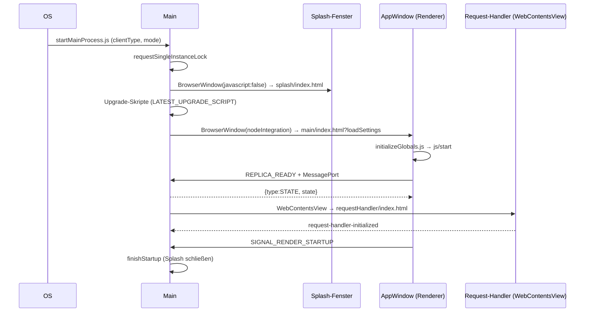
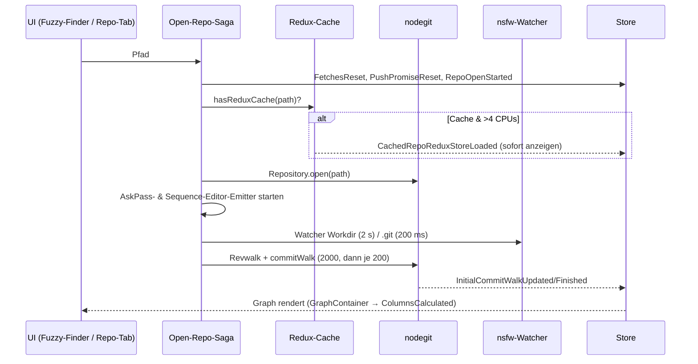
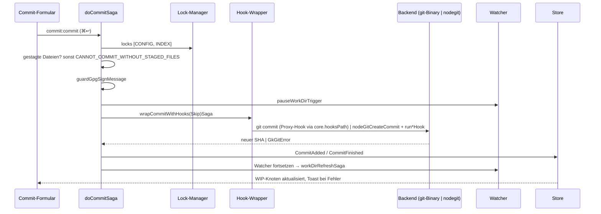
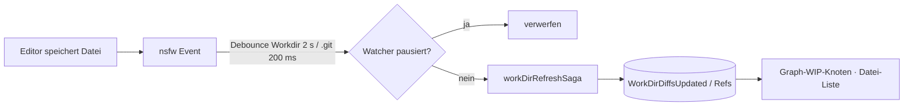
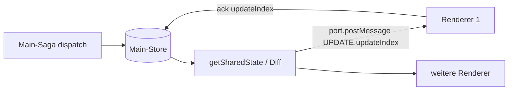

# 07 – Datenflüsse

Legende: **[N]** nachgewiesen · **[P]** plausibel · **[U]** unbekannt. Diagramme fassen Befunde aus 02–06 zusammen; jede Kante verweist auf die Fundstelle im jeweiligen Dokument. Sequenzen sind **statisch rekonstruiert**, nicht zur Laufzeit beobachtet.

## 1. Start der Anwendung


Belege: 02 (Splash, Upgrade, Fenster), 03 (Replica, Request-Handler), `appIpcMessageChannels.SIGNAL_RENDER_STARTUP` [N], `getRendererReadyPromise…finishStartup` [N] `main-all@567697`. Reihenfolge Request-Handler vs. Renderer-Start: **[P]**.

## 2. Repository öffnen


Belege: 06 §1, §2; 04 (Watcher-Intervalle, commitWalk). Cache-Bedingung `>4` **[P]** (06 §1).

## 3. Commit erstellen


Belege: 06 §4, 04 (Hooks, Lock-Modell).

## 4. Pull mit Credential-Abfrage

```mermaid
sequenceDiagram
  participant UI as Toolbar Pull
  participant S as pullSaga
  participant E as buildAskPassGitOverrides
  participant G as git pull (spawn)
  participant A as AskPass (rust-socket-bridge | AskPassClient.js)
  participant R as Renderer-Socket-Server
  participant M as Main (credsIpcMessageChannels)
  UI->>S: pull
  S->>S: Upstream? sonst promptSetUpstreamForRef; Remotes? sonst promptToAddRemote
  S->>E: env (GIT_ASKPASS, SSH_ASKPASS, Port)
  S->>G: git pull …
  G->>A: Passwort-Prompt
  A->>R: TCP 127.0.0.1 · ask_pass → ready · JSON\0
  R->>M: GET_HTTP_CREDENTIALS / ACQUIRE_OR_WAIT_FOR_CREDENTIALS_LOCK
  M-->>R: Credentials | Dialog nötig
  R-->>A: Antwort
  A-->>G: stdout
  G-->>S: Exitcode / stderr
  S->>S: FORCE_PUSH_ERROR_MESSAGES / GkGitError → Toast
```
Belege: 06 §6, 04 §5 (AskPass), 03 (`creds`-Kanäle). Exakte Zuordnung „Renderer fragt Main nach gespeicherten Credentials“ **[P]**.

## 5. Externe Dateiänderung


Belege: 04 (Watcher), 06 (Watcher-Pause). Ob `.git`-Events (refs) einen vollständigen Graph-Reload auslösen: **[U]**.

## 6. Main-Store-Replikation (Querschnitt)


Belege: 03 §3 (`main-all@374349`).
