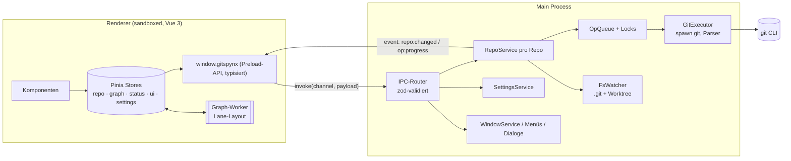
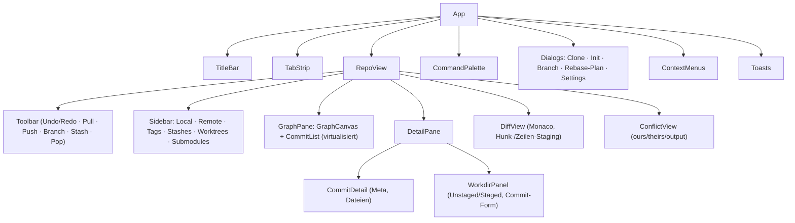

# 08 – Implementierungsplan „gitspynx“ (eigener Entwurf)

> Alles in diesem Dokument ist **Architekturvorschlag**, keine Beobachtung. Bezüge auf GitKraken verweisen auf die Analyse-Dokumente 02–07. Es wird kein proprietärer Code, keine Marke, kein Logo, kein Theme-Asset übernommen.

## Leitentscheidungen

| Thema | Entscheidung | Begründung (inkl. Bezug zur Beobachtung) |
|---|---|---|
| Shell | Electron (aktuell), TypeScript strict | Vorgabe |
| UI | Vue 3 (`<script setup>`), Pinia, Vite (electron-vite) | Vorgabe |
| Git-Backend | **Git-CLI** (System-Git, optional gebündelt) – kein libgit2 | GitKraken pflegt zwei Backends (nodegit + Binary) parallel und verlangt für manche Features bereits das Binary (`Error-RebaseOntoSelectionRequiresGitBinary`, 04). Ein Backend halbiert die Komplexität; die CLI deckt Rebase/Hooks/LFS/Signing/Credential-Helper vollständig ab. |
| Prozess-Isolation | Renderer `sandbox:true, contextIsolation:true, nodeIntegration:false`; Preload mit typisierter `contextBridge`-API | GitKraken betreibt den Renderer mit voller Node-Integration (03). Das ist bequem, aber ein unnötiges Risiko (Remote-Inhalte, Markdown, Avatare im selben Prozess wie `fs`/`child_process`). |
| Git-Ausführung | im **Main-Process** (bzw. später `utilityProcess`), nicht im Renderer | Folgt aus der Isolation; hält lange Git-Läufe aus dem UI-Thread. |
| Nebenläufigkeit | Pro Repo eine Operations-Queue mit benannten Locks (`index`, `refs`, `worktree`) | Übernimmt das *Konzept* der `{locks, saga}`-Operationen (02/04), nicht deren Code. Lesende Befehle mit `--no-optional-locks`. |
| Dateisystem-Watch | `fs.watch(…, {recursive:true})` (Node ≥ 20, macOS/Windows/Linux) mit Debounce; Fallback `@parcel/watcher` erst bei Bedarf | GitKraken nutzt `nsfw` (native). Node-Bordmittel reichen für den Start. |
| Graph | eigene Lane-Berechnung (TypeScript, Web Worker) + Canvas-Rendering + virtualisierte Liste | GitKraken rechnet Suche/Diff3 in Workern (02). Canvas skaliert auf 100k+ Commits. |
| Diff/Editor | Monaco (MIT) als Diff-Viewer, eigene Hunk/Line-Stage-Logik | Monaco ist MIT-lizenziert; Staging-Logik selbst. |
| Terminal | später: `node-pty` + xterm.js (MIT) | optional, Phase 4 |
| Settings | JSON unter `app.getPath('userData')`, Schema-validiert (zod), Migrationen versioniert | analog zu `~/.gitkraken/config` + Upgrade-Skripte (02), aber Standardpfad. |
| Secrets | Electron `safeStorage` | statt eigenem `secFile`. |

## Zielarchitektur



## Module

| Modul | Verantwortung |
|---|---|
| `shared/ipc-contract.ts` | Einzige Quelle für Kanalnamen, Request-/Response-Typen (zod-Schemas) |
| `main/git/executor.ts` | `run(args, {cwd, env, stdin, signal})`, Fehler-Mapping, Timeouts, `GIT_TERMINAL_PROMPT=0` |
| `main/git/parsers/*` | `status --porcelain=v2 -z`, `log -z --format=…`, `for-each-ref --format`, `diff` (unified) |
| `main/git/ops/*` | fachliche Operationen (commit, checkout, merge, rebase, stash …), jede deklariert ihre Locks |
| `main/repo/RepoService.ts` | Repo-Lebenszyklus, Watcher, Snapshot (`refs`, `status`, `HEAD`, Merge/Rebase-State) |
| `main/repo/OpQueue.ts` | Serialisierung je Lock, Abbruch, Fortschritt |
| `renderer/stores/*` | Pinia: `repos`, `graph`, `workdir`, `selection`, `ui`, `settings` |
| `renderer/graph/*` | Lane-Algorithmus (Worker), Canvas-Renderer, Hit-Testing |
| `renderer/components/*` | siehe Komponentenbaum |

## Komponentenbaum (Vorschlag)



## Datenmodelle (Vorschlag)

```ts
type Sha = string;
interface Commit { sha: Sha; parents: Sha[]; author: Person; committer: Person; subject: string; body: string; refs: RefName[] }
interface Person { name: string; email: string; date: number /* epoch s */ }
interface Ref { name: string; kind: 'local' | 'remote' | 'tag' | 'stash' | 'head'; target: Sha; upstream?: string; ahead?: number; behind?: number }
interface GraphRow { sha: Sha; lane: number; color: number; edges: { from: number; to: number; color: number; kind: 'straight' | 'merge' | 'fork' }[] }
interface FileChange { path: string; oldPath?: string; status: 'A'|'M'|'D'|'R'|'C'|'U'|'?'; staged: boolean; conflicted?: boolean }
interface RepoState { path: string; head: { ref?: string; sha: Sha; detached: boolean }; operation?: 'merge'|'rebase'|'cherry-pick'|'revert'|'bisect'; refs: Ref[]; files: FileChange[] }
interface OpRequest { repo: string; op: string; args: unknown; locks: ('index'|'refs'|'worktree')[] }
```

## Git-Befehlsabbildung (Kern)

| Funktion | Befehle |
|---|---|
| Repo öffnen | `rev-parse --show-toplevel --git-dir`, `for-each-ref`, `status --porcelain=v2 -z --branch` |
| Graph | `log --all --topo-order -z --format=%H%x00%P%x00%an%x00%ae%x00%at%x00%s` (paginiert, `--skip/-n`), Lane-Layout im Worker |
| Staging | `add -- <p>`, `restore --staged -- <p>`, Hunk/Zeile: `apply --cached --unidiff-zero` mit erzeugtem Patch |
| Commit | `commit -F -` (stdin), `--amend`, Signing über Git-Konfig |
| Branches | `switch [-c]`, `branch -d/-D`, `branch -m`, `push origin --delete` |
| Remote | `fetch --all --prune`, `pull --ff-only|--rebase`, `push [-u] [--force-with-lease]` |
| Merge/Rebase/Cherry-Pick | `merge`, `rebase [-i]` mit generiertem Todo via `GIT_SEQUENCE_EDITOR`, `cherry-pick`, `--continue/--abort/--skip` |
| Konflikte | `ls-files -u`, `show :1:p :2:p :3:p`, Ergebnis schreiben + `add` |
| Stash | `stash push [-m] [-- paths]`, `stash list -z --format`, `stash apply/pop/drop` |
| Suche | `log --grep/--author/-S/-G`, clientseitiger Filter auf geladenen Commits |
| Undo | Reflog-basiert (`reflog`, `reset`/`update-ref`) – bewusst erst spät, siehe Roadmap |

Credentials: zuerst System-Credential-Helper und SSH-Agent nutzen; eigener `GIT_ASKPASS`-Helper (kleines Node-Skript, das per IPC-Socket fragt) erst, wenn nötig – GitKraken löst das mit einer eigenen Rust-Brücke (04).

## Priorisierte Roadmap

| # | Meilenstein | Inhalt | Akzeptanz |
|---|---|---|---|
| M0 | Gerüst | electron-vite, TS strict, Preload-API, IPC-Contract, ESLint, Vitest, CI | App startet, `ping` über IPC typisiert |
| M1 | Repo öffnen + Graph (read-only) | Open/Recent, Refs, Commit-Log paginiert, Lane-Layout + Canvas, Commit-Detail | 100k-Commit-Repo scrollt flüssig |
| M2 | Workdir | Status, Stage/Unstage Datei, Diff-View, Commit/Amend | Commit-Zyklus komplett ohne Terminal |
| M3 | Branches | create/switch/rename/delete, Sidebar, Kontextmenüs | |
| M4 | Remote | fetch/pull/push, Upstream, ahead/behind, Credentials via Helper | Push auf GitHub/GitLab per SSH & HTTPS |
| M5 | Merge/Rebase/Cherry-Pick + Konflikte | inkl. Konflikt-Editor, continue/abort | |
| M6 | Stash | Liste im Graph, push/apply/pop/drop | |
| M7 | Suche & Filter | Commit-Suche (Worker), Branch-Filter/Solo/Hide | |
| M8 | Tabs & Workspaces | mehrere Repos, Repo-Gruppen | |
| M9 | Settings, Themes, Shortcuts, Command Palette | eigene Theme-Tokens, Keymap-Datei | |
| M10 | Fortgeschritten | Interaktiver Rebase (Drag&Drop), Hunk/Zeilen-Staging, Undo/Redo, Worktrees, Submodule, LFS, Terminal | |

Bewusst **nicht** geplant: Cloud-Accounts, PR-/Issue-Integrationen, AI-Features, Lizenzierung – sie machen den Großteil der GitKraken-IPC-Fläche aus (03), sind aber für eine lokale Git-App unnötig.
